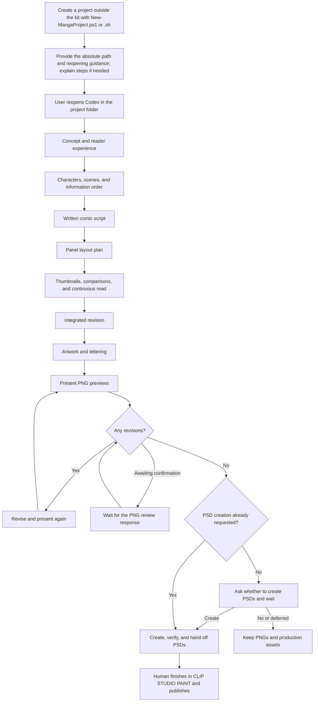

# Comic Production Kit — English Edition

Knowledge, ten skills, and a project template for planning a comic with Codex and developing its written script, thumbnails, artwork, and PNG review.

This kit was originally designed for creating manga for Japanese-speaking readers. This English edition was produced through automated AI translation of that Japanese kit, with subsequent localization and review. Some guidance and expressive conventions may still reflect Japanese manga practices.

This edition uses **US English, left-to-right and top-to-bottom panel and balloon order, and horizontal English lettering**. Dialogue is normally centered within balloons and uses standard English punctuation. Source filenames and machine identifiers are retained where needed for compatibility. Source citations retain their original Japanese wording. See [English maintenance records](docs/localization/README.md) for translation policy, validation, independent semantic review, and Japanese-upstream updates. Source kit version: **0.4.2**; localization revision: **0.4.2-en-US.1**.

**This folder maintains and distributes the kit. Normally, create a separate project outside it with `scripts/New-MangaProject.ps1` (or `scripts/New-MangaProject.sh` on Linux), reopen Codex there, and make your comic in that project.** `templates/manga-project/` is the master template; do not write a work directly into it.

The original author also reports that much of the kit can be used by giving ChatGPT Work this repository's URL along with comic characters and a story. This is a retained description of the author's usage, not a new verification of current product availability.

## What you can do

After opening a separate project, you can:

- Design the reader experience and story, developing a written script into thumbnails.
- Design pages around the intended staging using a library of 79 panel-layout templates as the starting point.
- Review story, immersion, cinematic staging, readability, terminology, and character consistency.
- Consult supervision guidance for humor, appeal, emotion, relationships, and developments, obtaining script options and improvements after previewing images.
- Draw using available image-generation/editing tools, then inspect and revise PNGs.
- Once PNG revisions are complete, create, verify, and hand off any requested PSDs.
- When asked to test staging in video, assist with generation/retrieval in local ComfyUI and video editing.

## Production workflow



Stage deliverables and checks are in the [Production workflow](docs/knowledge/manga/08-workflow-review.md); knowledge and templates are in the [Know-how index](templates/manga-project/docs/MANGA-KNOWHOW.md). Explanations of what this folder can do also begin with creating and reopening a separate project.

## Getting started

### Linux (Bash and Python 3.10 or later)

PowerShell and additional Python packages are not required. Run from the repository root:

```bash
bash scripts/New-MangaProject.sh --project-name 'My Comic' --what-if
bash scripts/New-MangaProject.sh --project-name 'My Comic'
# Another existing parent directory and Claude mode
bash scripts/New-MangaProject.sh 'My Comic' --destination-parent .. --agent-mode Claude
# Production with Gemini (Antigravity)
bash scripts/New-MangaProject.sh 'My Comic' --agent-mode Antigravity
# Carry forward requirements only from an explicitly named project
# bash scripts/New-MangaProject.sh 'Next Comic' --process-requirements-from '../Previous Comic'
```

`--what-if` (`--dry-run`) previews placement without creating files. Names may contain Japanese characters and spaces. Existing projects are not overwritten; copying through links is rejected. Legacy argument names `-ProjectName`, `-DestinationParent`, `-AgentMode`, `-ProcessRequirementsFrom`, and `-WhatIf` also work. You may invoke the entry point by path from any working directory. Relative destinations and inheritance sources are resolved from the current working directory. Set `PYTHON` to an interpreter executable path, or let the wrapper find `python3`, then `python`.

After creation, move to the displayed project folder. Review and optional-skill entry points are included in the project:

```bash
bash scripts/Resolve-ReviewProfile.sh
bash scripts/Initialize-OptionalSkills.sh
python3 scripts/process_checker.py status
```

Optional Japanese polishing skills are disabled by default and apply only to Japanese source text. Enabling them, external retrieval, and Gemini use follow the [existing consent procedure](docs/knowledge/optional-skills.md). Project creation on Linux does not retrieve optional skills, generate artwork, or call paid APIs. Use each `.sh` entry point's `--help` for arguments. On Linux, match the case of configured preset names, scene names, and choices. JSON results go to stdout; guidance and errors go to stderr. Calling through `bash` works even if ZIP extraction loses executable permissions.

### Windows PowerShell

Run from the repository root in Windows PowerShell 5.1 or later. Existing `.ps1` entry points, arguments, `-WhatIf`, and `-Confirm` remain available. Windows creation does not require installing the Linux Python implementation; requirements inheritance still requires Python as before.

```powershell
.\scripts\New-MangaProject.ps1 -ProjectName 'My Comic' -WhatIf
.\scripts\New-MangaProject.ps1 -ProjectName 'My Comic'
```

The kit primarily targets Codex with its available built-in image generation. Only when producing with Claude, such as Claude Code, add `-AgentMode Claude`. This adds `CLAUDE.md` and Claude adaptations in `AGENT-MODE.md`, including the default use of NovelAI for art when built-in image generation is unavailable. Without that option, creation uses the default Codex configuration.

```powershell
.\scripts\New-MangaProject.ps1 -ProjectName 'My Comic' -AgentMode Claude
```

For production with Gemini (Antigravity), specify `-AgentMode Antigravity`. This adds `GEMINI.md` and a dedicated `AGENT-MODE.md`. Reopen Antigravity in the displayed project folder. Codex remains the default; Antigravity files are distributed only when explicitly selected.

```powershell
.\scripts\New-MangaProject.ps1 -ProjectName 'My Comic' -AgentMode Antigravity
```

Antigravity mode checks available generation, editing, and image viewing tools before artwork. It defaults to NovelAI panel generation with separate composition, requiring an API key, style selection, and cost checks. Chrome, Edge, and built-in browser control are prohibited. Optional Japanese polishing stays disabled by default; installing or making additional calls to Gemini polishing skills requires the existing consent procedure. See [adaptations and verification scope](templates/manga-project/agent-modes/antigravity/AGENT-MODE.md). This mode does not cover other environments such as Gemini CLI. Operation in an actual Antigravity environment is unverified.

The default destination is `../My Comic/`. To use another parent, specify an existing relative path with `-DestinationParent` that places the project outside the kit. The repository folder may be renamed. Existing projects are not overwritten. `-WhatIf` only previews placement; it does not create a project.

On success, the script displays the **absolute destination path** and a message to reopen Codex there. When Codex creates it, Codex also verifies that it exists and replies with both a clickable Markdown link and the same absolute path as copyable text. This absolute path is for reopening; documents, settings, and saved records use relative paths.

### Reopen Codex in the created project

After creation, Codex says “Please reopen Codex in this folder,” and adds: **“If you need help, tell me your environment (Windows or Mac, app or VS Code), and I can explain the steps.”** If you know how, you can open the project without replying. Reopening instructions are researched only when requested, using current official information for your environment with source URLs and a check date. See [Reopening Codex](docs/knowledge/codex-operation.md#reopen-codex-in-the-project-folder).

Open the displayed project folder in the app or VS Code and start a new Codex conversation there. Running the creation script alone does not change this conversation's working folder. Read the project's `AGENTS.md`, `project.json`, `docs/PLAN.md`, and `docs/PROGRESS.md`, then record the aim in `docs/story/BRIEF.md` and begin. Common production knowledge and skills are copied into the project. NovelAI style samples still reference the kit's `resources/novelai-style-samples/index.html`, so retain the kit when using those samples. To resume an existing work, open that project instead of creating a new one.

<a id="exception-producing-a-comic-inside-the-kit"></a>

### Exception: producing a comic inside the kit

Normally use the separate project described above. Proceed with this exception only when the user explicitly insists on production inside the kit.

1. The user personally creates `特別な理由でこのフォルダの中で漫画を作ります.txt` in the kit root using a text editor or similar tool. The compatibility filename means “I am making a comic inside this folder for a special reason.” Check that it has no duplicate extension or alternate name.
2. Codex verifies that an ordinary file with that exact name exists. Do not begin without it. Codex must not create it for the user, copy it, or run a command that generates it.
3. Begin exceptional production only with both the explicit instruction and the file. Its presence alone is not a production request.

Do not distribute this file in templates or new projects; exclude it from Git commits. Store exceptional production assets and manuscripts in private areas such as `.work/`, separate from common knowledge, skills, and project templates. Editing the kit's own documents/scripts or conducting distribution tests does not require this marker.

## Scope and requirements

Image-generation tools, PSD creation/reloading tools, CLIP STUDIO PAINT, and model files are not bundled. The kit provides procedures for checking the necessary environment and proceeding. Video utilities require Python 3.10 or later; editing requires ffmpeg and ffprobe.

Without a PSD instruction, ask whether to create it after PNG revisions are confirmed and wait for the answer. Do not ask again if it has already been requested. Create CBZ only when explicitly requested. Record feedback only when asked to retain it; do not ask whether to record it.

## Frequently asked questions

### May I publish a comic made with this kit? Is credit required?

Yes. The repository's author claims no rights in your comic and imposes no additional restrictions on it merely because you used this kit. Credit for using the kit is optional.

For works with strongly political content or strong hostility toward others, the author asks that you refrain from credit or other wording associating the work with this kit. This is a request from the author, not a condition limiting use.

When using third-party works, characters, or assets, including fan works, check the relevant rights holders' guidelines and terms. The kit also assumes AI services may be used during production; users are responsible for checking the applicable service and model terms.

### Which ChatGPT model should I use?

The original author reports prototyping and operating on ChatGPT Pro with “Astra ExtraHigh.” The author also tried “Astra Ultra” but did not perceive a major difference beyond apparently greater allowance consumption. At the time of the original writing, reports on X described producing roughly 16–18 pages within a five-hour limit using the Work screen on ChatGPT Plus.

These are historical impressions from the author's environment and contemporaneous social-media reports, not current verified specifications. Model names, reasoning options, and limits may change. Complexity of the work and changes in Astra's capabilities or limits may affect results.

### Can I set parameters before production?

See the project's `OPTION.md`. Options include panel-template use, selection rates by panel count, limits on repeated three-wide-tier layouts, lettering direction, and PSD creation. Ask Codex about `OPTION.md` at the start if you want an explanation of how each option changes behavior. Unspecified choices use defaults; this English edition defaults to horizontal English and left-to-right reading.

### What changed in version 0.4.2?

Version 0.4.2 adds Linux entry points for project creation, review-profile resolution, and optional-skill initialization; an explicitly selected Antigravity mode; and NovelAI V5 production observations, prompt relationship checks, comparisons using the same seeds, and V15 guidance for presenting difficult actions while preserving their intent. The observations retain their one-project/model/input limits. Existing projects are not automatically updated. Create a separate project with this kit to use the new files; the US English reading and lettering defaults remain in effect.

### What changed in version 0.4.1, and how do I use it?

There are four main changes. As with 0.4.0, first create a project and open Codex or Claude in that folder. They do not automatically apply to projects created with 0.4.0 or earlier; create a new project with 0.4.1 to use the new features.

The original update mainly improved use with other agents such as Claude Code or Grok and with the NovelAI API. The established Codex plus built-in imagegen workflow that generates balloons inside the image was largely unchanged. Users not using Claude, Grok, or NovelAI would therefore see relatively few changes from that upstream update. The English edition additionally localizes reading direction, lettering, documentation, and reusable text assets.

1. **Claude Code production mode**

   Add `-AgentMode Claude` during project creation to make a Claude-oriented project. It adds `CLAUDE.md` and `AGENT-MODE.md` with Claude-specific adaptations.

   **Usage:** Run `.\scripts\New-MangaProject.ps1 -ProjectName 'My Comic' -AgentMode Claude` in the kit root, or ask, “Create a project for making this comic with Claude.” Then reopen Claude in the project. Without the option, creation remains Codex-oriented.

   The included Claude mode defaults to NovelAI for art because it assumes no built-in image generation; it requires an API key and style selection. Connections to NovelAI may require permission in Claude Code's settings.

**The following features may still need more testing.**

2. **Human-repeatable NovelAI generation commands**

   Save each panel's NovelAI request as JSON and use `scripts/novelai_batch.py` for generation → candidate adoption → page rebuilding. After Codex draws, a person can regenerate individual pages or panels, choose preferred candidates, and rebuild PNGs/PSDs with the same layout. Page commands are recorded in the project's `docs/production/NOVELAI-BATCH.md`.

   **Usage:** Run commands like these at the project root. Without `--execute`, `generate` previews the request without sending it. Add a cost-confirmation flag only after actually checking the condition.

   ```powershell
   python -X utf8 scripts/novelai_batch.py generate --page 1                     # Preview without sending
   python -X utf8 scripts/novelai_batch.py generate --page 1 --execute --confirm-zero-anlas --cost-note 'How and when the cost was checked'
   python -X utf8 scripts/novelai_batch.py list --page 1                         # List candidates
   python -X utf8 scripts/novelai_batch.py adopt p01-02 --candidate 3            # Adopt a candidate
   python -X utf8 scripts/novelai_batch.py build --page 1                        # Rebuild; add --write-psd for PSD
   ```

   You can also ask, “Regenerate panel 2 on page 3 and show me the candidates.” The workflow generates one prototype of the main characters before full production so appearance mismatches can be corrected first.

   **Batch changes to character prompts, only on request:** Ask to put each character's appearance prompt in an `.env` variable. Appearance specifications can be consolidated into `NOVELAI_CHAR_…` variables. Editing their values and running `generate` then changes those specifications across all panels.

3. **Balloon and lettering script**

   For lettering after drawing, `scripts/typeset_manga.py` places balloons, dialogue, in-art text, and panel borders on transparent layers and checks overflow and related issues. The original Japanese release supported vertical dialogue; the English edition defaults to horizontal, centered English text. Balloon choices include normal speech, whisper (dashed), shout (spiked), radial burst, narration, and internal monologue. Tails point toward the speaker's mouth. Use fonts from project `assets/fonts/` or the OS; fonts are not bundled.

   **Usage:** Codex normally handles this without additional setup. Request changes such as “Use a shout balloon for this line” or “Point the tail toward A's mouth.”

   imagegen defaults to generating text and balloons inside the image; NovelAI and other methods default to adding them after drawing. You need not choose a lettering method at creation. With imagegen, you may still request separate lettering, such as “Add the text afterward” (the “Text and balloon finishing” option in `OPTION.md`).

4. **Panel artwork from roughs and reference images, using external generation such as Qwen**

   The `manga-external-panel-i2i` skill adds a procedure for generating original panel art through Qwen, NovelAI, or other external tools conditioned on Blender renders, roughs, and character/prop references. It includes cautions drawn from Qwen-Image 2.1 production records, such as confusing characters' left/right positions or filling in unwanted faces.

   **Usage:** Specify the environment and inputs, for example, “Use this Blender composition render and character references to draw each panel with Qwen.” The procedure comes from production records; its effects with other models remain unverified.

Other additions include a post-artwork comparison table and post-lettering checks in thumbnail review. They require opening generated images and comparing them with the plan. Rules also clarify that voice examples in a brief are not ready-made dialogue, speech balloons need tails, unrequested titles/page numbers should not be added, and NovelAI prompts should describe visible forms.

### What changed in version 0.4.0, and how do I use it?

There are five main changes.

Use the request examples below after creating a project and opening Codex in it. Characters, synopsis, and page count are normally enough to begin a comic for web publication. You need not fill every configuration field; preferences can be given conversationally.

**If you choose Japanese prose polishing through Gemini (agy) or the NovelAI API, relevant text or generation instructions are sent to external services and may consume allowances or incur charges. Confirm the service, material sent, and cost conditions. Gemini allowance use must be approved before installation; NovelAI generation consuming Anlas requires explicit instructions covering that use. These options do not guarantee the intended expression or improved quality.** Japanese-polishing options are retained for Japanese-language work and are not English-polishing defaults.

1. **Scene-specific supervision**

   The kit includes knowledge for 16 themes, including comedy, straight-man responses, romance, fear, and reversals. Use it for script consultation and improvement proposals after viewing PNG previews.

   **Usage:** Name the scene and intended effect, for example, “Review this scene so the embarrassment and affection come through,” or “View this PNG and suggest ways to make the joke clearer.” You do not need to name a specialist skill.

   The 15 themes other than comedy are experimental. General reader effects remain unverified, so check each project's PNGs and trial reads. Use is not guaranteed, nor is improvement in quality.

2. **Panel layout and page-generation improvements**

   Templates remain the default, with custom layouts available where staging requires them. imagegen uses a numbered layout image as a reference and normally generates the whole page at once. Afterward, check panel placement, reading order, and dialogue.

   **Usage:** Usually no extra instructions are needed. You may ask for custom layout on showcase pages, mandatory templates on all pages, or free design without templates. The project's “Panel layout templates” option in `OPTION.md` also controls this. See [Panel template policy](docs/knowledge/panel-layout-policy.md).

   Templates were already included in version 0.3, but Codex often failed to use them; this update sought more reliable use.

3. **NovelAI asset generation and page assembly**

   Added a workflow in which NovelAI generates artwork and Codex places frames, balloons, and text. The kit includes ten style samples and 114 transparent sound-effect assets, supports recoloring, and can export PSDs preserving untouched original art. This English edition supplies English sound effects in three visual styles with stable asset IDs and editable SVG sources.

   **Usage:** After creating a project, obtain a persistent API token from account settings on the official NovelAI site and set `NOVELAI_API_KEY` in the project's `.env`. `.env.example` is only a field-name example; never put the actual key there. Then ask to generate art with NovelAI and add frames and text afterward.

   If no style is selected, Codex gives you the sample file's location. Open it yourself in a browser and provide the preferred style ID. Codex waits for selection before drawing. See [NovelAI production workflow](templates/manga-project/docs/knowledge/novelai-composed-production.md).

   If you also want a PSD, ask for one after PNG confirmation that preserves original art and separates artwork, balloons, and text. It is created after PNG revisions are confirmed. For rasterized lettering, the original dialogue text is included in the handoff.

   **A saved API-key file may be readable by Codex with execution access or by connection code. The kit instructs Codex never to print the key in answers, logs, or shared files. This is a behavioral rule, not a guarantee against unintended output or disclosure. Git ignore settings do not prevent Codex from reading the file.** If a leak is suspected, regenerate the token in NovelAI and update its usage settings. Issuing a new token invalidates the old one, according to the [公式のトークン取得・更新手順](https://docs.novelai.net/ja/text/usersettings/account/) checked on 2026-09-21. The source URL retains the original Japanese documentation provenance.

4. **Registering and carrying forward personal required steps**

   The process checker records tasks you always want performed. When reporting production progress, Codex compares those requirements with the manuscript and review records. On resume, it rereads both the requirements and prior implementation records, identifies unperformed or unverified work, and then continues. Explicitly selected requirements may also carry forward into the next project.

   **Usage:** For example, “Ask the process checker to register reviewing character goals and actions when the written script is complete as a required step from now on.” Codex discusses applicability and check timing with you and saves it within the project.

   Choose “Instruction,” checked during progress reports, or “Strong instruction,” also written into project working rules. To reuse requirements, ask to carry them forward during project creation in the kit and specify the previous project's folder.

   **This helps Codex detect and address missed registered tasks. It does not guarantee that no work will be missed or that quality will improve.** Register and revise requirements through repeated use as production reveals what is needed.

5. **Print settings, particularly experimental**

   `PRINT-OPTION.md` consolidates print-only trim dimensions, bleed, crop marks, binding margins, resolution, color, and submission format according to the printer's specifications. It is disabled by default and unnecessary for web-only PNGs.

   **Usage:** Specify the printer, product, and desired trim size, for example, “Prepare this as a left-bound US comic for this printer; check its official submission specifications and set up print output.” Provide any established specifications or official URL.

   To configure manually, set “Print output” to “Enabled” in the project's `PRINT-OPTION.md` and fill what you know. Resolve missing specifications with Codex. Preserve web masters and PNGs and prepare print data separately.

   The file organizes and cross-checks print conditions, including required pixel dimensions and clipped text. Request PSD creation or transmission to the printer separately if needed.

   **Print settings are experimental. Printer acceptance and actual printed results remain unverified; submission compliance and print quality are not guaranteed. Before submitting, compare against current printer specifications and inspect clipped text, bleed, binding margins, color, and detail at actual size. Consult the printer or obtain proofs as needed.**

   Image-generation allowance consumption can vary with generation size, quality, and regeneration count. Final PNG output size differs from generation size. Locally enlarging and exporting an existing image does not itself generate an image, but enlargement alone may not supply the detail needed for print. [OpenAI公式の画像生成・利用枠の説明](https://learn.chatgpt.com/docs/image-generation) was checked on 2026-09-21 for differences by size and quality; this citation records that historical check.

Other expanded areas include web dimensions, margins and line widths, optional Japanese prose polishing, dialogue alignment and punctuation, character/performance/readability guidance, carrying revisions forward to later pages, and distribution verification. The English edition replaces Japanese top-aligned dialogue and punctuation restrictions with centered horizontal English and standard English punctuation.

Express preferences conversationally or in `OPTION.md`, for example, “Export the final PNG at 2000 × 3000 pixels.” For a Japanese-language project, you may request humanizer-jp for dialogue and internal monologue.

Japanese-polishing skills are disabled by default. When enabled, Codex installs the selected skill in the project and uses it on the selected material. See [Optional polishing skill procedures](docs/knowledge/optional-skills.md) for selection, first installation, resumption checks, and disabling. Gemini authorization conditions are described at the start of this FAQ item.

You can ask Codex about usage.

### What changed in version 0.3?

Earlier behavior frequently produced monotonous pages with three vertically stacked panels. The workflow was improved to select from prepared panel-layout patterns, enabled by default. If you prefer free layout without those patterns, tell Codex before production or change `OPTION.md`.

## Related documentation

- [Documentation guide](docs/README.md)
- [Architecture and distribution](docs/architecture.md)
- [Sources and retrieval dates](docs/SOURCES.md) and [Scope of film and screenwriting references](docs/knowledge/manga-sources.md)
- [Verification before committing from this folder](docs/publication.md)
- [Usage terms and third-party material](docs/RIGHTS.md)

See `distribution-version.txt` for the current distribution version. [Examples](examples/README.md) contain public PNG/JPEG images and production conditions. They are for viewing and are not copied into new projects. The bundled comic pages use English lettering and left-to-right sequencing; text-free pages and character references are retained where compatible. See the [example localization record](docs/localization/EXAMPLE-LOCALIZATION.md) for scope and source provenance.
