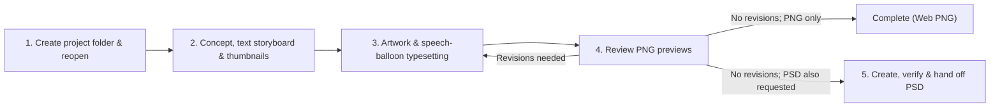

# Comic Production Kit (MangaAgentsStudio-A) — English Edition

A collection of **knowledge, 12 skills, helper scripts, and a project template** for planning a comic with an AI agent (such as Codex) and progressing through written scripts (text storyboards), thumbnail layouts, artwork, lettering, PNG review, and optional PSD export.

This kit was originally designed for creating manga for Japanese-speaking readers. This English edition was produced through automated AI translation of that Japanese kit, with subsequent localization and review. Some guidance and expressive conventions may still reflect Japanese manga practices.

This edition uses **US English, left-to-right and top-to-bottom panel and balloon order, and horizontal English lettering**. Dialogue is normally centered within balloons and uses standard English punctuation. Source filenames and machine identifiers are retained where needed for compatibility. Source citations retain their original Japanese wording. See [English maintenance records](docs/localization/README.md) for translation policy, validation, independent semantic review, and Japanese-upstream updates. Source kit version: **0.5.4**; localization revision: **0.5.4-en-US.1**.

> [!IMPORTANT]
> - **This kit is not a standalone comic-creation application.** Prepare an AI agent to collaborate with (such as Codex, Claude Code, or Antigravity) and an image-generation method to produce the artwork (such as the image-generation tool available in a Codex environment, the NovelAI API, the PixAI API, or local ComfyUI) separately.
> - **This folder maintains and distributes the kit.** Do not draw a comic directly here; create a separate project folder for each work outside the kit (by default `../ProjectName/` one level up) and **reopen the agent in that project folder** to begin production. `templates/manga-project/` is the distribution master; do not write a work directly into it.

See **[Public examples](examples/README.md)** for sample finished pages and production conditions (examples are for viewing and are not copied into new projects).

---

## What you can do

After opening a created project folder, you can work with your AI agent through conversation on the following stages:

- **Planning, text storyboards, and thumbnail layouts**: Design the reader experience and story, then develop character settings and a text storyboard into per-page thumbnail layouts.
- **Panel layout design**: Design pages around the intended staging using a library of 79 panel-layout templates as the starting point.
- **Multi-angle review and scene supervision**: Inspect story, immersion, cinematic staging, readability, terminology, and character consistency, and obtain staging ideas or post-PNG improvement suggestions across 16 scene-supervision themes (humor, appeal, emotion, relationships, and developments).
- **Artwork, speech-balloon typesetting, and PNG review**: Draw with an available image-generation method, typeset panel borders, speech balloons, and horizontal English dialogue as needed, and review and revise with PNG previews (local WebUIs operated in a browser are also bundled for NovelAI and PixAI).
- **Optional PSD handoff**: Once no PNG revisions remain, create, verify, and hand off a layered PSD only when requested (for finishing in CLIP STUDIO PAINT or similar software).
- **Optional video previsualization**: Upon explicit request, assist with video prototyping using local ComfyUI and ffmpeg.

---

## Choosing how to use the kit (local environment / ChatGPT Work)

You can choose between two entry points depending on your environment:

| Method | Characteristics and best fit | Available functionality |
| --- | --- | --- |
| **1. Use locally with Codex or another agent (standard, recommended)** | Extract this kit on your PC and open it with a local-folder-capable agent such as Codex (desktop app / VS Code extension), Claude Code, or Antigravity | **Features matching your prepared environment and permissions.** Supports creating project folders outside the kit, typesetting via bundled scripts, NovelAI / PixAI batch generation and local WebUIs, PNG previews, and optional PSD export (see the next section for required drawing tools, Python environment, execution permissions, and unverified items) |
| **2. Pass the repository URL to ChatGPT Work or a similar chat environment (lightweight use)** | Without setting up a local environment, pass this repository's URL (`https://github.com/potechitakusan/MangaAgentsStudio-A`) in a ChatGPT Work conversation and give instructions | Planning, text storyboards, and thumbnail consultations referencing the repository's knowledge, production workflow, and panel-layout policy, plus approximate features such as image generation to the extent supported by that conversation environment |

### Example prompt and notes when passing the URL to ChatGPT Work

When having ChatGPT Work or a similar environment reference the repository URL, ask along these lines:

> **Example request (ChatGPT Work):**
> "Please refer to the structure and comic production rules in `https://github.com/potechitakusan/MangaAgentsStudio-A`. Plan a 2-page comic where two women play a board game on their day off and there is a reversal at the end, starting from the text storyboard and thumbnail layout. First check whether image generation and file output are available in this environment."

- **Difference from a local environment**: Simply passing the URL does not create a project folder on your local PC or automatically set up all local skills, API keys, and the Python script environment.
- **Environment-dependent constraints**: Repository retrieval scope, file saving, script execution, availability of image generation, and how deliverables are downloaded depend on the capabilities and permissions of the ChatGPT Work environment you are running (unverified behaviors and delivery methods are not guaranteed).
- **Working-folder principle**: Even if the execution environment can extract the repository and manipulate files, keep the principle of creating a separate project folder outside the kit rather than modifying the master in `templates/manga-project/` directly.

---

## Required environment and drawing methods

You can choose the **AI agent** that drives production and the **drawing method** that generates the artwork separately. **You do not need to subscribe to or install every service—preparing one drawing method you want to use is enough.**

### 1. AI agent for production (choose one)

| Agent | Project creation option | Characteristics and notes |
| --- | --- | --- |
| **Codex** (ChatGPT app / VS Code extension, etc.) | None (default) | The standard environment for this kit. **Not every Codex environment includes built-in image generation (`imagegen`)**, so at the start of a project the agent checks whether an image-generation tool is available in the current conversation (if not, choose NovelAI, PixAI, or another method) |
| **Claude** (Claude Code, etc.) | `-AgentMode Claude`<br>(Linux: `--agent-mode Claude`) | Adds `CLAUDE.md` and adaptation rules (`AGENT-MODE.md`) to the project. Because there is no built-in image generation, it defaults to external drawing (NovelAI, PixAI, etc.) plus separate typesetting |
| **Gemini (Antigravity)** | `-AgentMode Antigravity`<br>(Linux: `--agent-mode Antigravity`) | Adds `GEMINI.md` and a dedicated `AGENT-MODE.md` to the project. Checks available generation and image-viewing capabilities before drawing (defaults to per-panel generation such as NovelAI plus separate typesetting). *Not for Gemini CLI. Operation in an actual Antigravity environment is unverified.* |

### 2. Drawing method (choose one)

| Drawing method | Required preparation and API key | Additional costs and allowance handling | Text, speech balloons, and panel frames | Verification status and detailed guides |
| --- | --- | --- | --- | --- |
| **Codex built-in image generation (`imagegen`)** | A Codex environment where the image-generation tool is available (no extra API key setup required) | Consumes the ChatGPT / Codex plan's image-generation allowance (varies with size, quality, and regeneration count) | Supply a numbered layout reference image and **generate the whole page at once with text and balloons included** by default | Operation verified.<br>[Panel layout and generation policy](docs/knowledge/panel-layout-policy.md) |
| **NovelAI API**<br>(V5 default / V4.5) | NovelAI account, **Persistent API token** (`NOVELAI_API_KEY`), and Python 3.10+ | **0 Anlas** with an active **Opus subscription** under no-Anlas conditions (1 image per request, 28 steps or fewer, standard dimensions, no extra paid features; remaining V5 allowance must be checked). Non-Opus or paid conditions consume Anlas (executed only with explicit permission) | Generate artwork without text or frames per panel, then **typeset frames, balloons, and dialogue afterward via script** | Single-image generation, batch generation, and WebUI verified (image inputs such as i2i are unverified). Samples for all 11 styles included.<br>[NovelAI production workflow](templates/manga-project/docs/knowledge/novelai-composed-production.md), [API connection procedure](docs/knowledge/novelai-api.md) |
| **PixAI API**<br>(Tsubaki.2 default; 15 official models included) | PixAI account, **API key** (`PIXAI_API_KEY`), and Python 3.10+ | **Consumes PixAI credits on every generation.** Because there is no balance-check API, run only within the scope explicitly permitted by the human after checking balance and image count | Generate artwork without text or frames per panel, then **typeset frames, balloons, and dialogue afterward via script** | v2 generation, WebUI, and some v1 features verified (includes partially verified features; LoRA effectiveness and per-model credit consumption are unconfirmed). Samples for 15 models + 35 styles included.<br>[PixAI production workflow](templates/manga-project/docs/knowledge/pixai-composed-production.md), [API connection procedure](docs/knowledge/pixai-api.md) |
| **External generation / rough-reference i2i**<br>(ComfyUI / Qwen-Image 2.1, etc.) | Local ComfyUI or an external generation environment, plus roughs (such as Blender renders) and character reference images | Local execution uses machine resources (when using external services, follow each service's terms) | Draw per panel, then typeset frames, balloons, and text afterward | Includes production records with Qwen-Image 2.1 (whether other models achieve the same effect is unverified).<br>[Per-panel drawing with external generation](docs/knowledge/external-panel-i2i.md) |

### 3. OS, Python, additional packages, and finishing tools

What runs with "no additional Python packages required" versus what requires image-processing packages such as `Pillow` is divided as follows:

| Task / stage | Required OS and runtime environment | Additional Python packages and external tools |
| --- | --- | --- |
| **Creating a project folder** | - Windows: Windows PowerShell 5.1+<br>- Linux: Bash + Python 3.10+<br>(*For Mac, only reference information for official app steps is included; unverified on actual hardware*) | **No additional packages required** (standard library only; on Windows, Python 3.10+ is used only when carrying forward required process steps from a previous project). Git is not required for ordinary use |
| **API key check, subscription check, request JSON creation, and launching the WebUI itself** | Python 3.10+ (`novelai_api.py`, `novelai_compose.py`, `pixai_api.py`, `pixai_compose.py`, and each WebUI server) | **No additional packages required** for key checks, subscription checks, ordinary text-only request creation, or launching the WebUI. **`Pillow` is required** for PixAI **i2i / inpaint request creation** (checking source image and mask dimensions) and converting WebP/JPEG responses to PNG |
| **Speech-balloon and dialogue typesetting, page PNG builds, and mask creation** | Python 3.10+ (`typeset_manga.py`, `novelai_batch.py build`, `pixai_batch.py build`, `pixai_mask.py`) | **`Pillow` is required** (uses fonts in project `assets/fonts/` or standard OS fonts) |
| **Exporting and reload-verifying composed PSDs** | **Python 3.12+** (when using the bundled pinned dependencies: `export_composed_psd.py` and each `build --write-psd`) | **`Pillow`, `numpy`, and `psd-tools` are required** (listed in project `scripts/requirements-composition.txt`. Pinned `numpy==2.5.3` requires Python 3.12+; see [project setup](templates/manga-project/docs/SETUP.md) for the source) |
| **Installing optional Japanese prose-polishing skills** | Only when enabled in the project's `OPTION.md` for Japanese source text (disabled by default) | `humanizer-jp` uses **Git**. `japanese-natural-writing` requires a **Gemini (`agy`) environment** and explicit permission to consume quota |
| **Final finishing (optional)** | **CLIP STUDIO PAINT** (standard assumption when a human finishes and publishes the work) | **Not required if you only want web PNGs.** Used when finishing layered PSDs |
| **Video previsualization (optional)** | Only when explicitly requested (not used in ordinary comic production) | Python 3.10+, `ffmpeg`, `ffprobe`, and local ComfyUI |

---

<a id="getting-started"></a>

## Getting started (shortest path to your first comic)

You can start by asking Codex to create the project folder without typing commands yourself.

### Step 1. Obtain and extract this kit

Prepare the kit folder on your PC using either method:

- **Without Git (easiest)**: On the GitHub page, click the green **"Code"** button → **"Download ZIP"**, and extract the downloaded ZIP file into a working folder on your PC.
- **With Git**: Run `git clone https://github.com/potechitakusan/MangaAgentsStudio-A.git` (or clone this English edition repository).

### Step 2. Open the kit folder in Codex and ask it to create a project

Open the extracted kit folder (the folder containing this `README.md`) in Codex (the ChatGPT desktop app or VS Code extension) and ask:

> **Example first request (run in the kit folder):**
> "Following this kit's procedure, create a project called 'My First Comic' outside the kit. Show me the destination path and which folder to open next."

Codex runs the creation script and gives you the **absolute path** to the created project folder (normally `../My First Comic/` one level up).

### Step 3. Reopen Codex in the created project folder

Open the displayed **absolute path of the project folder** in the app or VS Code, and start a **new Codex conversation** there.

- Running the creation script alone does not switch the working folder of your current conversation. Always start a new conversation in the project folder.
- When creation finishes, Codex says "Reopen Codex in this folder," and adds: **"If you need help, tell me your environment (Windows or Mac; app or VS Code), and I will explain the steps."** If you already know how to open it, you can open the project folder directly without replying (see [Reopening Codex](docs/knowledge/codex-operation.md#reopen-codex-in-the-project-folder)).
- Production knowledge, skills, and scripts are copied into the project folder, but **NovelAI style samples** (`resources/novelai-style-samples/index.html`) and **PixAI model and style samples** (`resources/pixai-model-samples/index.html`) are referenced from the kit folder, so keep the kit folder without deleting it.

### Step 4. Request comic production in the project folder

In the new conversation inside the project folder, tell the agent the characters, synopsis, and page count for the comic you want to make.

> **Example project request (checking available tools such as `imagegen` first):**
> "Make a 2-page comic with a punchline at the end where two women play a game on their day off. First check what image-generation methods are available, and take it through web PNG previews. No PSD is needed."

> **Example project request (specifying NovelAI or PixAI):**
> "Make a 2-page comic with a punchline at the end where two women play a game on their day off. Use NovelAI (or PixAI) for the artwork, and guide me through the style samples and API key connection check first. Take it through web PNG previews; no PSD is needed."

- The prompts above are conversation examples. Artwork will not be generated automatically if no image-generation method (built-in `imagegen`, or configured NovelAI / PixAI / external image environment) is available.
- Codex creates and updates record files in the project such as `docs/story/BRIEF.md`, `docs/PLAN.md`, and `docs/PROGRESS.md` from your conversation. **You do not need to fill out every configuration file or planning sheet by hand before starting** (only tell the agent in conversation or edit the project's `OPTION.md` if you want to change preferences such as panel-layout policy or dimensions).

---

## OS-specific commands to create a project yourself (manual execution / Claude / Antigravity)

If you want to create a project folder yourself from the terminal instead of leaving it to Codex, or if you want to specify the mode for Claude Code or Antigravity, run the following at the kit root.

### Windows PowerShell (5.1 or later)

```powershell
# Preview placement only (creates no files)
.\scripts\New-MangaProject.ps1 -ProjectName 'My Comic' -WhatIf

# Create in ../My Comic/ with default (Codex) mode
.\scripts\New-MangaProject.ps1 -ProjectName 'My Comic'

# For production with Claude (Claude Code, etc.; adds CLAUDE.md and AGENT-MODE.md)
.\scripts\New-MangaProject.ps1 -ProjectName 'My Comic' -AgentMode Claude

# For production with Gemini (Antigravity; adds GEMINI.md and dedicated AGENT-MODE.md)
.\scripts\New-MangaProject.ps1 -ProjectName 'My Comic' -AgentMode Antigravity

# Change the destination parent folder or carry forward registered process requirements from a previous project
.\scripts\New-MangaProject.ps1 -ProjectName 'My Comic' -DestinationParent '..' -ProcessRequirementsFrom '..\Previous Comic'
```

### Linux (Bash and Python 3.10 or later)

PowerShell is not required. Calling through `bash` works even if executable permissions were lost during ZIP extraction.

```bash
# Preview placement only (--dry-run is synonymous)
bash scripts/New-MangaProject.sh --project-name 'My Comic' --what-if

# Create in ../My Comic/ with default (Codex) mode
bash scripts/New-MangaProject.sh --project-name 'My Comic'

# Another existing parent directory, Claude mode, Antigravity mode, or carrying forward requirements
bash scripts/New-MangaProject.sh 'My Comic' --destination-parent .. --agent-mode Claude
bash scripts/New-MangaProject.sh 'My Comic' --agent-mode Antigravity
# bash scripts/New-MangaProject.sh 'Next Comic' --process-requirements-from '../Previous Comic'
```

- Project names may contain Japanese characters, English letters, numbers, spaces, hyphens, and underscores. Existing folders with the same name are not overwritten, and copying through symbolic links or junctions is rejected. Legacy argument names `-ProjectName`, `-DestinationParent`, `-AgentMode`, `-ProcessRequirementsFrom`, and `-WhatIf` also work.
- You can specify the Python executable path via the `PYTHON` environment variable; when unset, the wrapper searches `python3`, then `python`.
- For details on Antigravity mode, see [Adaptations and verification scope](templates/manga-project/agent-modes/antigravity/AGENT-MODE.md).

### Optional helper scripts (not needed on first run)

After creating a project, the following helper scripts are available inside the project folder as needed, but **humans do not need to run them manually before starting ordinary comic production** (the AI agent guides or runs them when needed).

```bash
# Check review priority weights (on Windows: .\scripts\Resolve-ReviewProfile.ps1)
bash scripts/Resolve-ReviewProfile.sh

# Install optional Japanese polishing skills when enabled in OPTION.md (disabled by default; consent procedure in docs/knowledge/optional-skills.md)
bash scripts/Initialize-OptionalSkills.sh

# Check personal required steps registered with the process checker (0 by default)
python3 scripts/process_checker.py status
```

---

## Production workflow and division of roles (PNG review and optional PSD)

Once production begins in the project folder, it proceeds in the following order. Detailed state transitions and per-stage checklists are collected in the [Production workflow](docs/knowledge/manga/08-workflow-review.md) and [Know-how index](templates/manga-project/docs/MANGA-KNOWHOW.md).



### Division of roles between the human and the AI agent

| Stage | What the human (you) does | What the AI agent (Codex, etc.) does | Done only on request (optional) |
| --- | --- | --- | --- |
| **Preparation and planning** | Start a new conversation in the project folder and provide characters, synopsis, page count, and drawing method | Check `OPTION.md`, fill in `BRIEF.md`, `PLAN.md`, and `PROGRESS.md`, and draft and review the text storyboard, panel layout, and thumbnail layout | Detailed settings in `OPTION.md`, scene-supervision consultations, enabling optional Japanese polishing skills |
| **Artwork and typesetting** | Choose a style/model, and **verify costs/allowances and authorize execution before API generation** | Assemble prompts, verify content, run generation within the authorized scope, and typeset and inspect frames, speech balloons, and horizontal English dialogue | Edit prompts/variables or choose candidate images in the local WebUI |
| **PNG review** | Inspect the presented PNG previews (or page-flipping HTML viewer) and request revisions or approve | Regenerate, adjust typesetting, and re-present pointed-out areas (waiting until a reply arrives) | Consult the scene-supervision skill for PNG improvement ideas |
| **PSD and finishing** | After confirming no PNG revisions remain, answer whether to create a PSD | When instructed, create and reload-verify the PSD and hand it off along with the dialogue source (`DIALOGUE.md`) | Finish in CLIP STUDIO PAINT, print settings (`PRINT-OPTION.md`), CBZ creation, video previsualization |

### Positioning and cautions for PNG, PSD, and print settings

- **Web PNG review comes first**: Present PNG previews first and adjust until no revisions remain. Silence is never treated as "no revisions."
- **PSD creation happens after PNG confirmation and only when requested**: If you already said "No PSD needed" or "Make a PSD after PNG confirmation" from the start, the agent follows that; if unspecified, it asks "Would you like to create a PSD?" after PNG confirmation and waits for your answer (see [PSD handoff rules](docs/knowledge/psd-handoff.md)).
- **Accurate understanding of what is editable in a PSD**:
  - A PSD stores **the asset units that were actually kept separate during production** as layers. In a NovelAI / PixAI composed build (`--write-psd`), untouched adopted original art (hidden group), placed images with panel-frame masks, and transparent layers for balloons and lettering are saved separately.
  - By contrast, **when `imagegen` generates art, balloons, and text together as a single image, exporting a PSD does not automatically split characters, backgrounds, and text into separate layers or turn text inside the image into editable text layers.** So that rasterized lettering can be re-entered in CLIP STUDIO PAINT or similar software, the finalized dialogue text is saved in `docs/production/DIALOGUE.md` and handed off together.
- **Print settings (`PRINT-OPTION.md`)**: Settings for print submission are separated into `PRINT-OPTION.md` (disabled by default; experimental). You do not need to fill it out when making web PNGs only.

---

## NovelAI / PixAI setup and using the local WebUI

This is the workflow for generating panel assets with NovelAI or PixAI and typesetting pages.

### 1. First-time setup (inside the project folder)

1. **Set the API key**: Write your key on a single line in the project folder's `.env` (or `.secrets/novelai.env` / `.secrets/pixai.env`; see the next section, "[Costs, external transmission, and API key management](#costs-external-transmission-and-api-key-management)").
2. **Verify the connection (no image generation or charges)**: Tell the agent "Check my NovelAI (or PixAI) connection," or run the following in a terminal at the project folder:
   ```powershell
   # For NovelAI (use python on Windows, python3 on Linux)
   python -X utf8 scripts/novelai_api.py key-status
   python -X utf8 scripts/novelai_api.py status

   # For PixAI
   python -X utf8 scripts/pixai_api.py key-status
   python -X utf8 scripts/pixai_api.py status
   ```
3. **Choose a style or model**: Pick the style or model you want from the kit-side sample catalogs (`resources/novelai-style-samples/index.html` with 11 styles for NovelAI; `resources/pixai-model-samples/index.html` with 15 official models + 35 style presets for PixAI).
4. **Prompt-editing guides**: If you want to put character appearance, style, and backgrounds (plus LoRA in PixAI) into variables and edit them yourself, see the guides inside the project:
   - For NovelAI: [Editing and regenerating NovelAI characters, style, and backgrounds](templates/manga-project/docs/novelai-prompts/README.md)
   - For PixAI: [Editing and regenerating PixAI characters, style, backgrounds, and LoRA](templates/manga-project/docs/pixai-prompts/README.md)

### 2. Preparation before launching the local WebUI and operating steps

NovelAI (`novelai-batch-webui`) and PixAI (`pixai-batch-webui`) include local WebUIs that let you edit prompts and variables, run generation, adopt candidate images, and build page PNGs/PSDs in a browser window.

> [!IMPORTANT]
> **The WebUI is not a tool for planning and creating an entire comic from scratch in an empty project folder using only the browser screen.**
> In particular, the PixAI WebUI has no screen for creating request JSON files from zero, so **before launching it, ask your AI agent to prepare the request JSON for each panel and the page configuration**.

#### What you need before launching

- A created **project folder** (NovelAI WebUI is bundled in 0.5.3+ and PixAI WebUI in 0.5.4+. Older existing projects are not updated automatically; ask the agent to import them if needed).
- **Python 3.10+ to launch the WebUI** (`Pillow` is required for page PNG builds and WebP/JPEG conversion. **To build PSDs with the bundled pinned dependencies as well, prepare Python 3.12+** plus `Pillow`, `numpy`, and `psd-tools`).
- A configured **API key** (`NOVELAI_API_KEY` or `PIXAI_API_KEY`).
- **Per-panel request JSON files** (`input/novelai/requests/` or `input/pixai/requests/`), **page layout and typesetting definitions** (`input/pages/` and `input/typeset/`), and optional **prompt variables** (`.env.novelai` or `.env.pixai`) created by the AI agent.

#### Example request to prepare for the WebUI

If you do not yet have request JSON files or page configurations, ask the agent in your project folder first:

> **Example WebUI preparation request:**
> "Without running generation yet, please prepare the request JSON for all panels, the page layout and typesetting files, and the character variables so I can edit and generate in the WebUI."

#### Launch commands and operating order

Once prepared, open a terminal at the **project folder root** and launch the WebUI (on Linux, replace `python` with `python3`).

| Target | Default port | Launch command at project root | Detailed specification |
| --- | --- | --- | --- |
| **NovelAI WebUI** | `8765` | `python -X utf8 .agents/skills/novelai-batch-webui/novelai_webui.py` | [NovelAI WebUI skill](skills/novelai-batch-webui/SKILL.md) |
| **PixAI WebUI** | `8775` | `python -X utf8 .agents/skills/pixai-batch-webui/pixai_webui.py` | [PixAI WebUI skill](skills/pixai-batch-webui/SKILL.md) |

1. **Launch from the project root**: Running the command above prints a tokenized URL such as `http://127.0.0.1:8765/?token=…` (`8775` for PixAI).
2. **Open the displayed URL in your browser yourself**: Because the rules prohibit the AI agent from launching or controlling a browser, the human opens the URL. **Do not publish or share the tokenized URL externally.**
3. **Edit variables and requests**: Edit characters, style, and backgrounds in the "Variables" tab, or adjust per-panel prompts, position pins (NovelAI), aspect ratios, and mode/LoRA (PixAI) in the "Panels" tab.
4. **Verify costs/allowances and generate**: In the generation dialog, check the cost confirmation box, enter the verification note (`--cost-note`), and start generation (the NovelAI WebUI supports verified 0-Anlas runs only; run paid Anlas generations from the terminal).
5. **Adopt candidates**: Compare generated candidate images and choose "Adopt" or "Adopt latest for all."
6. **Build and review page PNGs**: Build page PNGs in the "Pages" tab and inspect them in the "Preview" tab (with page-turn navigation) or the output image files.
7. **Build PSDs if needed**: Once no PNG revisions remain, run the "PSD" build only if needed.
8. **Stop the server**: Press `Ctrl+C` in the terminal to stop the WebUI server.

- **Caution when aborting or disconnecting during PixAI generation**: Even if you cancel waiting in the WebUI or terminal, **the generation task already created on PixAI's server continues to run.** Regenerating immediately will consume credits twice, so before regenerating, run **"Re-fetch from PixAI (`fetch`)"** in the "Panels" or "Logs / Connection" tab (or `python -X utf8 scripts/pixai_batch.py fetch --page 1` in the terminal) to recover the completed image.

---

<a id="costs-external-transmission-and-api-key-management"></a>

## Costs, external transmission, and API key management

For features that use cloud AI or external APIs, the kit distinguishes and manages what is sent to which service and which allowances or charges apply.

### 1. Allowances, additional charges, and external transmission

> [!WARNING]
> **Although the "local WebUI" and "local scripts" run on your PC, they communicate with the external NovelAI or PixAI APIs during authentication/subscription checks and image generation.** `status` uses the API key in the authentication header to query authentication or subscription status without sending project prompts or images. Generation sends prompts and settings, and also uploads specified images when using i2i or reference images.
>
> Non-network commands such as `key-status`, `list`, `vars`, dry runs without `--execute`, and local typesetting (`build`) do not transmit data externally.

| Target | What is sent externally | Allowances / costs consumed and safety rules |
| --- | --- | --- |
| **AI agent itself**<br>(Codex / Claude / Antigravity) | Conversation instructions, plus manuscripts, settings, and review images inside the project read by the agent | Each AI agent's plan allowance. The kit instructs agents not to output secret values such as API keys in conversations or logs, but this is a behavioral rule rather than a 100% guarantee against unintended output |
| **Codex built-in `imagegen`** | Panel-layout reference images and per-panel drawing prompts | ChatGPT / Codex plan image-generation allowance (varies by generation size, quality, and regeneration count) |
| **NovelAI API**<br>(`https://image.novelai.net`) | Prompts, negative prompts, and model settings in request JSON (plus source images if customized for i2i, etc.) | - **0 Anlas** with an **active Opus subscription (`tier=3`)** under no-Anlas conditions (1 image per request, 28 steps or fewer [V5 default 23 / V4.5 default 28], standard dimensions, no extra paid features).<br>- However, **0 Anlas under Opus is not the same as "free use without a subscription"** (both active subscription and remaining V5 allowance must be verified).<br>- Paid generations that consume Anlas are run from the terminal **only within the scope explicitly instructed by the user** (the subscription check API is queried automatically on the first run and roughly every 10 generations thereafter) |
| **PixAI API**<br>(`https://api.pixai.art`) | Prompts, negative prompts, and model/LoRA settings in request JSON, plus uploaded images when i2i, masks, or references are specified | - **Consumes PixAI credits on every generation.**<br>- Because there is no official balance or cost-check API, the cost confirmation flags in the scripts and WebUI (`--confirm-credits` and `--cost-note`) are **not an automatic free-tier check or exact price calculation, but a declaration that the user has authorized the credit consumption.**<br>- **4 candidates per request (`batchSize: 4`)** generates 4 images in a single task, affecting image count and credit consumption (under the default `auto`, regenerating a panel that already has candidates uses 4 images) |
| **Optional Japanese prose-polishing skill**<br>(`japanese-natural-writing`) | Dialogue, narration, and other Japanese text specified as polishing targets (sent to Gemini) | **Disabled by default.** Even when enabled for Japanese source text, **permission to transmit text externally and consume Gemini quota** is always confirmed before installation or invocation; nothing is installed or sent without explicit consent (the other skill, `humanizer-jp`, only fetches the skill from GitHub on first installation and does not send text to an external API during polishing) |

### 2. Configuration files, API key storage locations, and loading priority

Inside a project folder, configuration files are separated so that secrets (API keys) are not mixed with prompt-editing variables.

- **Recommended storage location for first-time users**: The simplest method is to create a **`.env`** file directly in the project root and write `NOVELAI_API_KEY=YOUR_ACTUAL_TOKEN` or `PIXAI_API_KEY=YOUR_ACTUAL_KEY` (if you prefer to isolate secret files in a separate folder, you can use `.secrets/novelai.env` or `.secrets/pixai.env`).
- **Strict rule**: **Never paste actual API key values into your conversation with the AI, and never write them into public files or example files (`.env.example`, etc.).**

| File / location | Role and contents | Loading target and priority (per implementation) | Git tracking |
| --- | --- | --- | --- |
| **`.env`**<br>(recommended first) | **Shared settings** such as API keys (`NOVELAI_API_KEY`, `PIXAI_API_KEY`) and endpoint URLs | **Priority 4** for key loading. Write on a single line including the setting name on the left and `=` (e.g., `PIXAI_API_KEY=YOUR_ACTUAL_KEY`) | Ignored (private) |
| **`.secrets/novelai.env`**<br>**`.secrets/pixai.env`** | Service-specific API-key files | **Priority 2** for key loading (NovelAI reads `novelai.env`; PixAI reads `pixai.env`) | Ignored (private) |
| **`.secrets/.env`** | Shared API-key file inside `.secrets/` | **Priority 3** for key loading | Ignored (private) |
| **OS environment variables**<br>(`NOVELAI_API_KEY` / `PIXAI_API_KEY`) | Environment variables set in the terminal or OS | **Priority 1 (highest)** for key loading. If an old key remains here, it overrides file keys; use `key-status` to check the active source | — |
| **`.env.novelai`** | NovelAI character, style, and background prompt variables (`NOVELAI_CHAR_*`, etc.) and 4 helper settings | Read by `novelai_compose.py`, `novelai_batch.py`, and the NovelAI WebUI (do not put API keys here; migrate variables placed in `.env` in older versions with `novelai_batch.py env-migrate`) | Ignored (private) |
| **`.env.pixai`** | PixAI character, style, background, and LoRA variables (`PIXAI_CHAR_*`, `PIXAI_LORA_*`, etc.) and 5 helper settings | Read by `pixai_compose.py`, `pixai_batch.py`, and the PixAI WebUI (do not put API keys here) | Ignored (private) |
| **`.env.example`**<br>**`.env.novelai.example`**<br>**`.env.pixai.example`** | Example files showing field names and syntax | **Never loaded by scripts.** Writing actual keys or variables here has no effect and risks accidental publication—never put real values in them | Tracked (public template) |

---

## Resuming or updating an existing project, and the in-kit exception

### 1. Resuming an existing project

To continue working on a comic in progress, do not rerun `New-MangaProject`; instead, **open that project folder directly in Codex or your chosen agent** and start a conversation. The agent reads `docs/PROGRESS.md` and `docs/PLAN.md` in the project and resumes from where you left off.

### 2. Bringing kit updates into an existing project

Updating this distribution kit to a newer version **does not automatically update the contents of project folders you have already created.**

If you want to bring updated scripts or WebUI skills into a work in progress, do not copy the kit over the entire project folder (overwriting the whole folder risks wiping out your project's `OPTION.md`, story manuscripts in `docs/story/`, API keys in `.env` and `.secrets/`, and generation history in `input/` and `output/`). Instead, ask the agent inside your project conversation:

> **Example request to import kit updates into an existing project:**
> "While keeping all of this project's settings (`OPTION.md`, etc.), story and manuscript records (`docs/`), API keys and variables (`.env*` and `.secrets/`), and generated assets (`input/` and `output/`), compare this project against the source kit (`sourceKitRelativePath` in `project.json`) and import only the updated scripts, WebUI skills, and knowledge documents. Show me the list of files to be changed before overwriting."

<a id="exception-producing-a-comic-inside-the-kit"></a>

### Exception: producing a comic inside the kit

Normally use the separate project described above. Proceed with this exception only when the user explicitly insists on production inside the kit.

1. The user personally creates `特別な理由でこのフォルダの中で漫画を作ります.txt` in the kit root using a text editor or similar tool. The compatibility filename means "I am making a comic inside this folder for a special reason." Check that it has no duplicate extension or alternate name.
2. Codex verifies that an ordinary file with that exact name exists. Do not begin without it. Codex must not create it for the user, copy it, or run a command that generates it.
3. Begin exceptional production only with both the explicit instruction and the file. Its presence alone is not a production request.

Do not distribute this file in templates or new projects; exclude it from Git commits. Store exceptional production assets and manuscripts in private areas such as `.work/`, separate from common knowledge, skills, and project templates. Editing the kit's own documents/scripts or conducting distribution tests does not require this marker.

---

## Frequently asked questions (FAQ)

### Q. May I publish a comic made with this kit? Is credit required?
**A.** Yes, you may publish it. For comics created using this kit, the repository's author claims no rights in the deliverables and imposes no additional restrictions on use merely because this kit was used. Credit stating that you used this kit is also optional—you may include or omit it as you prefer.

However, when publishing works with strongly political content or strong hostility toward others, the author asks that you refrain from credit or other wording associating the work with this kit. This is a request from the repository author, not a condition restricting use.

When working with third-party copyrighted works, characters, or assets—including fan works—please check the guidelines and terms set by the respective rights holders. Because this kit assumes various AI services may be used during production, users are also responsible for checking the terms of use applicable to the services and models they use.

### Q. Which ChatGPT model should I use?
**A.** The original author reports prototyping and operating on the "ChatGPT Pro" plan with "Astra ExtraHigh" selected. The author also tested "Astra Ultra," but perceived no major difference in practice beyond an apparent increase in allowance consumption.
Reports on social media (X) at the time of writing also described creating roughly 16–18 pages within a 5-hour limit using the Work screen on a "ChatGPT Plus" plan.

*Note: The above reflects the author's environment and impressions at the time of writing, or social-media reports from that time; it does not mandate a specific plan or model as a requirement or guarantee how many pages can be created. ChatGPT model names, available reasoning settings, and usage limits may change in the future.*

*Please also note that results can vary depending on task complexity and changes in Astra's capabilities or limits.*

### Q. Are there parameters I can specify before starting production?
**A.** See `OPTION.md` inside your project folder. You can configure whether to use panel-layout templates, adoption rates by panel count, limits on repeating three-wide-tier layouts, lettering direction, PSD creation, and more.
If you want to check how each setting changes behavior in practice, you can also ask Codex directly about `OPTION.md` at the start of production.
Unspecified items use default settings; this English edition defaults to horizontal English lettering and left-to-right reading.

### Q. What changed in version 0.5.4?

**A.** Added support for PixAI (image generation via the PixAI API). Just as with NovelAI, you can ask your AI agent to take you from asset generation through page assembly. The main additions are:

- You can choose from 15 official PixAI models by name without looking up version IDs. You can compare the looks of the models and 35 style presets in the kit's `resources/pixai-model-samples/index.html`.
- You can use inpainting to fix only part of an already generated panel, or i2i to redraw the whole panel. For complex panels and regenerations, generating 4 candidates at once and choosing among them is now the default approach.
- Added example prompts to the "Variables" tab in both the NovelAI and PixAI WebUIs so you can ask the agent to set up bulk prompt adjustments.
- Added a browser-based WebUI (`pixai-batch-webui` skill) for running generation, adopting candidates, and building pages. Run the following in a terminal in your project folder and open the displayed `http://127.0.0.1:8775/?token=…` in your browser. Press `Ctrl+C` to stop.

```powershell
python -X utf8 .agents/skills/pixai-batch-webui/pixai_webui.py
```

- Create a PixAI API key in [API settings](https://pixai.art/profile/edit/api). Because generation consumes credits, the AI agent generates only within the scope authorized by the user.

**Comic production with PixAI includes features that are still under verification.** Undocumented features (such as i2i, inpainting, ControlNet, and reference images) may change without notice, and LoRA effectiveness as well as exact credit consumption per model have not been exhaustively verified. Further details are planned for version 0.6.0 as verification progresses.

### Q. What changed in version 0.5.3?

**A.** For projects that generate assets with NovelAI and typeset pages, we added a browser-operated WebUI (`novelai-batch-webui` skill). Without typing commands, you can edit character, style, and background variables in `.env.novelai` and prompts in request JSON files, run generation, adopt candidates, build page PNGs/PSDs, and flip through page previews.

To launch it, run the following in a terminal in your project folder and open the displayed `http://127.0.0.1:8765/?token=…` in your browser. Press `Ctrl+C` to stop. Python 3.10 or later is required.

```powershell
python -X utf8 .agents/skills/novelai-batch-webui/novelai_webui.py
```

It is copied into projects created in 0.5.3 or later. To use it in an older existing project, ask Codex to import it.

### Q. What changed in version 0.5.0 since the 0.4.0 release?

**A.** Version 0.5.0 includes the features added in 0.4.1 and 0.4.2 and the fixes made since. The main changes since the 0.4.0 release are summarized below.

Newly created projects receive the updated documents and scripts. Existing projects are not updated automatically. To bring the changes into a work in progress, ask Codex to compare it with the kit and make the necessary updates while keeping the project's own settings and revisions. The US English reading and lettering defaults of this edition remain in effect.

1. **Steps for editing and regenerating NovelAI characters, style, and backgrounds**

   Each panel's request JSON is saved so that a human can generate, choose candidates, and rebuild PNGs; PSDs can also be created when needed. The procedure for gathering prompts into `.env` (now `.env.novelai`) variables covers style and backgrounds as well as characters. You can edit the variable file directly, or edit separate text and apply it with a command, and Japanese values are also supported.

   Who does what, example requests for preparation, example prompt changes, and how to run the commands are collected in [Editing characters, style, and backgrounds](templates/manga-project/docs/novelai-prompts/README.md). You can start from a work whose prompts are already assembled or whose PNG previews are finished.

2. **NovelAI position pins, and per-panel requests and verification**

   We added a procedure for position pins, which specify where characters and other elements appear. It distinguishes V5 free placement from the 5×5 placement of V4/V4.5, reinforces positions in text, and checks the result after generation and after cropping. The API request example with coordinates is presented as a candidate to verify; actual generation results and placement accuracy are unverified. See the [position-pin production procedure](templates/manga-project/docs/knowledge/novelai-composed-production.md#position-pins) and the [API request example](docs/knowledge/novelai-api.md).

   We also made concrete the procedure for writing out, in each request, the contact between a character and an object, who does what, and the clothing, belongings, and positions that continue from the previous panel. It covers generation dimensions and cropping to fit the panel, warnings such as missing character features, and verification after generation. Even without automatic warnings, Codex checks the content of the requests and the images. See [NovelAI drawing and composition procedure](templates/manga-project/docs/knowledge/novelai-composed-production.md) for details.

3. **Typesetting of balloons and dialogue, and review after drawing**

   We added `scripts/typeset_manga.py` to projects for placing text after drawing. It handles balloon types, tails that point toward the speaker, dialogue layout, output to transparent layers, and overflow checks. We also added to the production procedure a comparison of the drawn images with the plan, and checks after typesetting. The original Japanese release supports vertical dialogue; the English edition defaults to horizontal, centered English text.

   Codex normally handles this, so tell it the balloons or revisions you want. With `imagegen`, text and balloons are generated inside the image by default; with NovelAI and similar methods, they are added separately after drawing. See [Text, balloons, and finishing](docs/knowledge/page-layout.md).

4. **Linux support, and creation modes for Claude and Gemini (Antigravity)**

   On Linux, a project can be created with Bash and Python 3.10 or later, so PowerShell is not required. Modes for Claude and for Antigravity were also added. Only when the human specifies the environment is the instruction file for that environment copied into the work. See [Getting started](#getting-started). Operation in an actual Antigravity environment is unverified.

5. **Procedure for external drawing that uses roughs and reference images**

   The `manga-external-panel-i2i` skill draws panels with Qwen or similar tools from Blender renders, roughs, and reference images of characters and props. Based on production records with Qwen-Image 2.1, it also collects cautions such as confusing a character's left and right and filling in unwanted faces. See [Panel drawing with external generation](docs/knowledge/external-panel-i2i.md). Whether other models achieve the same effect is unverified.

### Q. What changed in version 0.4.0, and how do I use it?

**A.** There are five main changes.

Use the request examples below after creating a project and opening Codex in it. Characters, synopsis, and page count are normally enough to begin a comic for web publication. You need not fill every configuration field; preferences can be given conversationally.

**If you choose Japanese prose polishing through Gemini (agy) or use the NovelAI API, relevant text or generation instructions are sent to external services and may consume allowances or incur charges. Confirm the service, material sent, and cost conditions. Gemini allowance use must be approved before installation; NovelAI generation consuming Anlas requires explicit instructions covering that use. These options do not guarantee the intended expression or improved quality.** Japanese-polishing options are retained for Japanese-language work and are not English-polishing defaults.

1. **Scene-specific supervision**

   The kit includes knowledge for 16 themes, including comedy, straight-man responses, romance, fear, and reversals. Use it for script consultation and improvement proposals after viewing PNG previews.

   **Usage:** Name the scene and intended effect, for example, "Review this scene so the embarrassment and affection come through," or "View this PNG and suggest ways to make the joke clearer." You do not need to name a specialist skill.

   The 15 themes other than comedy are experimental. General reader effects remain unverified, so check each project's PNGs and trial reads. Use is not guaranteed, nor is improvement in quality.

2. **Panel layout and page-generation improvements**

   Templates remain the default, with custom layouts available where staging requires them. `imagegen` uses a numbered layout image as a reference and normally generates the whole page at once. Afterward, check panel placement, reading order, and dialogue.

   **Usage:** Usually no extra instructions are needed. You may ask for custom layout on showcase pages, mandatory templates on all pages, or free design without templates. The project's "Panel layout templates" option in `OPTION.md` also controls this. See [Panel template policy](docs/knowledge/panel-layout-policy.md).

   Templates were already included in version 0.3, but Codex often failed to use them; this update sought more reliable use.

3. **NovelAI asset generation and page assembly**

   Added a workflow in which NovelAI generates artwork and Codex places frames, balloons, and text. The kit includes style samples (10 at the time of 0.4.0; currently 11) and 114 transparent sound-effect assets, supports recoloring, and can export PSDs preserving untouched original art. This English edition supplies English sound effects in three visual styles with stable asset IDs and editable SVG sources.

   **Usage:** After creating a project, obtain a persistent API token from account settings on the official NovelAI site and set `NOVELAI_API_KEY` in the project's `.env` (or `.secrets/novelai.env`). `.env.example` is only a field-name example; never put the actual key there. Then ask to generate art with NovelAI and add frames and text afterward.

   If no style is selected, Codex gives you the sample file's location. Open it yourself in a browser and provide the preferred style ID. Codex waits for selection before drawing. See [NovelAI production workflow](templates/manga-project/docs/knowledge/novelai-composed-production.md).

   If you also want a PSD, ask for one after PNG confirmation that preserves original art and separates artwork, balloons, and text. It is created after PNG revisions are confirmed. For rasterized lettering, the original dialogue text is included in the handoff.

   **A saved API-key file may be readable by Codex with execution access or by connection code. The kit instructs Codex never to print the key in answers, logs, or shared files. This is a behavioral rule, not a guarantee against unintended output or disclosure. Git ignore settings do not prevent Codex from reading the file.** If a leak is suspected, regenerate the token in NovelAI and update its usage settings. Issuing a new token invalidates the old one, according to the [公式のトークン取得・更新手順](https://docs.novelai.net/ja/text/usersettings/account/) checked on 2026-09-21. The source URL retains the original Japanese documentation provenance.

4. **Registering and carrying forward personal required steps**

   The process checker records tasks you always want performed. When reporting production progress, Codex compares those requirements with the manuscript and review records. On resume, it rereads both the requirements and prior implementation records, identifies unperformed or unverified work, and then continues. Explicitly selected requirements may also carry forward into the next project.

   **Usage:** For example, "Ask the process checker to register reviewing character goals and actions when the written script is complete as a required step from now on." Codex discusses applicability and check timing with you and saves it within the project.

   Choose "Instruction," checked during progress reports, or "Strong instruction," also written into project working rules. To reuse requirements, ask to carry them forward during project creation in the kit and specify the previous project's folder.

   **This helps Codex detect and address missed registered tasks. It does not guarantee that no work will be missed or that quality will improve.** Register and revise requirements through repeated use as production reveals what is needed.

5. **Print settings, particularly experimental**

   `PRINT-OPTION.md` consolidates print-only trim dimensions, bleed, crop marks, binding margins, resolution, color, and submission format according to the printer's specifications. It is disabled by default and unnecessary for web-only PNGs.

   **Usage:** Specify the printer, product, and desired trim size, for example, "Prepare this as a left-bound US comic for this printer; check its official submission specifications and set up print output." Provide any established specifications or official URL.

   To configure manually, set "Print output" to "Enabled" in the project's `PRINT-OPTION.md` and fill what you know. Resolve missing specifications with Codex. Preserve web masters and PNGs and prepare print data separately.

   The file organizes and cross-checks print conditions, including required pixel dimensions and clipped text. Request PSD creation or transmission to the printer separately if needed.

   **Print settings are experimental. Printer acceptance and actual printed results remain unverified; submission compliance and print quality are not guaranteed. Before submitting, compare against current printer specifications and inspect clipped text, bleed, binding margins, color, and detail at actual size. Consult the printer or obtain proofs as needed.**

   Image-generation allowance consumption can vary with generation size, quality, and regeneration count. Final PNG output size differs from generation size. Locally enlarging and exporting an existing image does not itself generate an image, but enlargement alone may not supply the detail needed for print. [OpenAI公式の画像生成・利用枠の説明](https://learn.chatgpt.com/docs/image-generation) was checked on 2026-09-21 for differences by size and quality; this citation records that historical check.

**Other expansions**

Other expanded areas include web dimensions, margins and line widths, optional Japanese prose polishing, dialogue alignment and punctuation, character/performance/readability guidance, carrying revisions forward to later pages, and distribution verification. The English edition replaces Japanese top-aligned dialogue and punctuation restrictions with centered horizontal English and standard English punctuation.

Express preferences conversationally or in `OPTION.md`, for example, "Export the final PNG at 2000 × 3000 pixels." For a Japanese-language project, you may request `humanizer-jp` for dialogue and internal monologue.

Japanese-polishing skills are disabled by default. When enabled, Codex installs the selected skill in the project and uses it on the selected material. See [Optional polishing skill procedures](docs/knowledge/optional-skills.md) for selection, first installation, resumption checks, and disabling. Gemini authorization conditions are described at the start of this FAQ item.

You can ask Codex about usage.

### Q. What changed in version 0.3?
**A.** Earlier behavior frequently produced monotonous pages with three vertically stacked panels. The workflow was improved to select from prepared panel-layout patterns, enabled by default. If you prefer free layout without those patterns, tell Codex before production or change `OPTION.md`.

---

## Related documentation (by audience)

- **Entry points for users and beginners**
  - [Documentation guide (links by purpose)](docs/README.md)
  - [Public examples](examples/README.md) (public PNG/JPEG images and production conditions; not copied into new projects. Bundled comic pages use English lettering and left-to-right sequencing; see the [example localization record](docs/localization/EXAMPLE-LOCALIZATION.md))
  - [Initial project setup](templates/manga-project/docs/SETUP.md)
  - [NovelAI prompt editing and regeneration guide](templates/manga-project/docs/novelai-prompts/README.md) / [PixAI prompt editing and regeneration guide](templates/manga-project/docs/pixai-prompts/README.md)
- **Production workflows and agent knowledge**
  - [Comic production workflow](docs/knowledge/manga/08-workflow-review.md), [Know-how index](templates/manga-project/docs/MANGA-KNOWHOW.md)
  - [NovelAI production workflow](templates/manga-project/docs/knowledge/novelai-composed-production.md) / [PixAI production workflow](templates/manga-project/docs/knowledge/pixai-composed-production.md)
  - [NovelAI WebUI skill](skills/novelai-batch-webui/SKILL.md) / [PixAI WebUI skill](skills/pixai-batch-webui/SKILL.md)
- **Kit maintenance, sources, and licensing**
  - [Architecture and distribution (distinguishing distributed files from kit-side references)](docs/architecture.md)
  - [Localization records](docs/localization/README.md)
  - [Sources and retrieval dates](docs/SOURCES.md), [Scope of film and screenwriting references](docs/knowledge/manga-sources.md)
  - [Usage terms and third-party material](docs/RIGHTS.md), [MIT License](LICENSE)
  - [Verification before committing from this folder](docs/publication.md)

See `distribution-version.txt` for the current distribution version.
