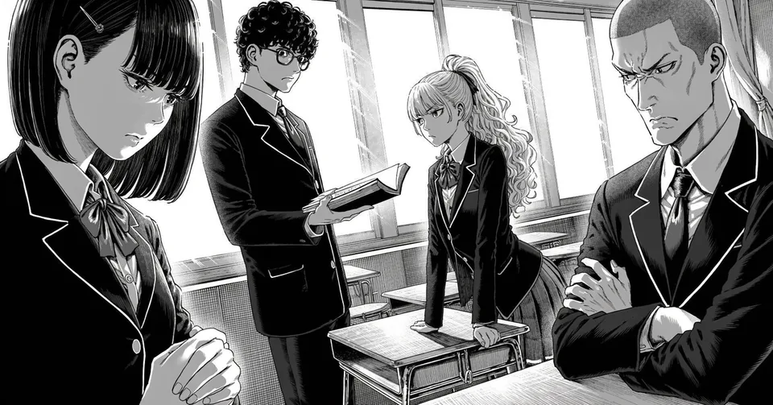
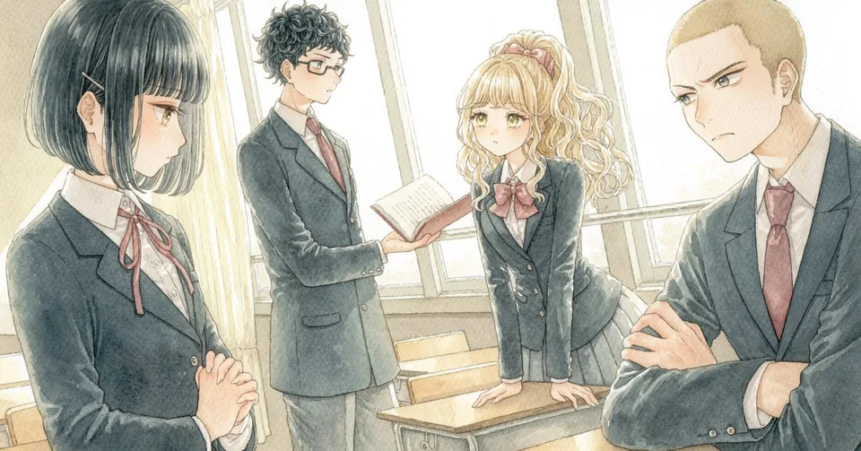
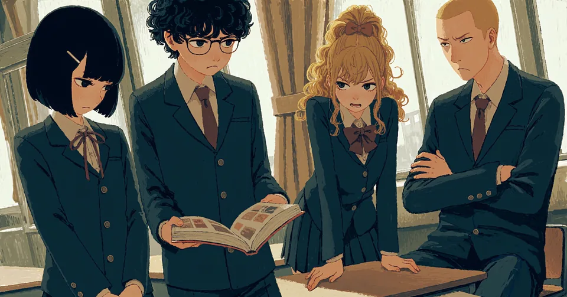
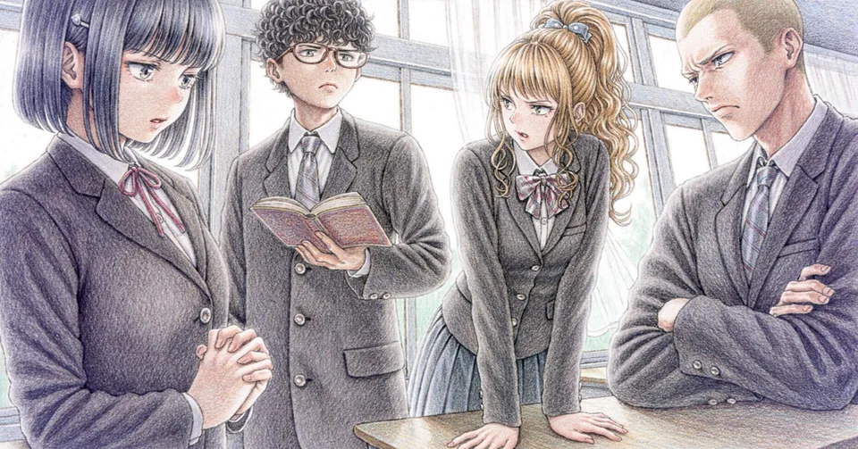
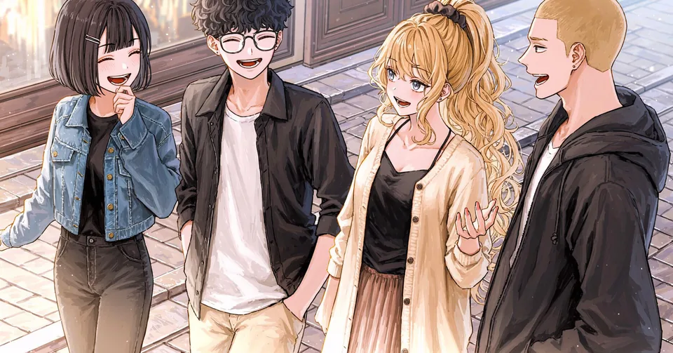
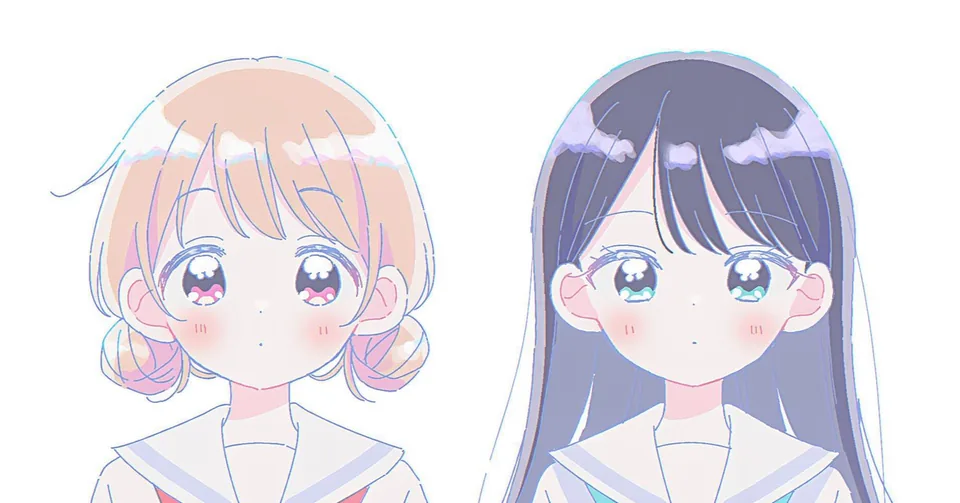
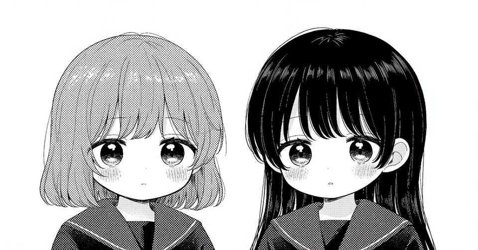
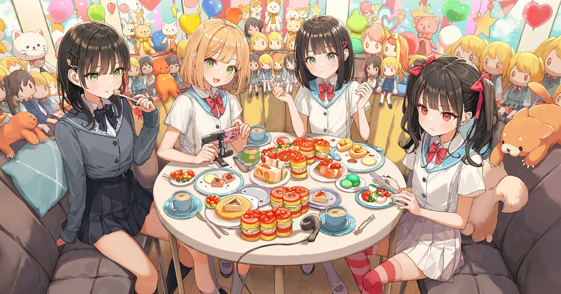

# 11 Art Styles — 17 Samples

Kit-only references. Tell the assistant the style ID you prefer (such as `style-01`).

- Sample images are not copied to new projects.
- Open [index.html](index.html) to search and filter images interactively. Raw data is in [catalog.json](catalog.json).

Shared generation parameters: nai-diffusion-5-curated, 1344×704px, steps 24, scale 5.5, sampler k_euler_ancestral. 1 image per run, no reference images. See each sample description for the generation date.

Generation workflow: `scripts/novelai_compose.py` (`--no-quality-tags --uc-preset none`, `--scale 5.5`) and `novelai_batch.py`.

## Table of Contents

| Name | Style ID | Sample ID |
| --- | --- | --- |
| [Solid blacks + hatching / Street](#style-01-street) | `style-01` | `style-01-street` |
| [Solid blacks + hatching / School](#style-01-school) | `style-01` | `style-01-school` |
| [Pale watercolor + ink / Street](#style-02-street) | `style-02` | `style-02-street` |
| [Pale watercolor + ink / School](#style-02-school) | `style-02` | `style-02-school` |
| [Opaque gouache / Street](#style-03-street) | `style-03` | `style-03-street` |
| [Opaque gouache / School](#style-03-school) | `style-03` | `style-03-school` |
| [Thick acrylic paint / Street](#style-04-street) | `style-04` | `style-04-street` |
| [Thick acrylic paint / School](#style-04-school) | `style-04` | `style-04-school` |
| [Colored pencil / Street](#style-05-street) | `style-05` | `style-05-street` |
| [Colored pencil / School](#style-05-school) | `style-05` | `style-05-school` |
| [Line art + painted shading / Street](#style-06-street) | `style-06` | `style-06-street` |
| [Line art + painted shading / School](#style-06-school) | `style-06` | `style-06-school` |
| [year 2025 / Two women — style test](#style-07-two-girls) | `style-07` | `style-07-two-girls` |
| [Stylized proportions, white pupils, and pastels / Two women — style test](#style-08-two-girls) | `style-08` | `style-08-two-girls` |
| [Cute pastel comic / Two women — style test](#style-09-two-girls) | `style-09` | `style-09-two-girls` |
| [Cute monochrome comic / Two women — style test](#style-10-two-girls) | `style-10` | `style-10-two-girls` |
| [Vivid colors, thin lines, and large round eyes / Two women — style test](#style-11-two-girls) | `style-11` | `style-11-two-girls` |

---

## Solid blacks + hatching / Street

<a id="style-01-street"></a>


- **Style ID**: `style-01`
- **Sample ID**: `style-01-street`
- **Description**: Four male and female characters in a diagonal composition. These two scenes illustrate one style; they do not guarantee consistency across a long story. Regenerated with V5 Curated on 2026-10-05 (using per-character prompts and position pins).

<details>
<summary>Prompt Details</summary>

```text
2girls, 2boys, walking along a shopping street, diagonal composition, dynamic angle, daylight, city shopping street, buildings, pavement, Monochrome black-and-white manga, gritty adventure art, variable-width dip-pen lines, large pure black ink masses, harsh white rim light, deep chiaroscuro, dense crosshatching, angular faces, realistic anatomy, white paper highlights.
Character 1 (position pin 0.15, 0.5): girl, black bob cut hair with bangs, small hairclip, denim jacket over black top, black pants, walking, laughing, looking at the group
Character 2 (position pin 0.38, 0.5): boy, short curly black hair, glasses, black jacket over white t-shirt, light pants, walking, talking, smiling
Character 3 (position pin 0.62, 0.5): girl, long wavy light hair in a high ponytail, long cardigan over black camisole, long skirt, walking, smiling, gesturing with one hand
Character 4 (position pin 0.85, 0.5): boy, tall, light buzz cut, black hooded jacket over white shirt, hands in pockets, walking, talking, looking at the group
Negative: color, flat cel shading, airbrush
seed: 212100245
```

</details>

---

## Solid blacks + hatching / School

<a id="style-01-school"></a>



- **Style ID**: `style-01`
- **Sample ID**: `style-01-school`
- **Description**: Four male and female characters in a diagonal composition. These two scenes illustrate one style; they do not guarantee consistency across a long story. Regenerated with V5 Curated on 2026-10-05 (using per-character prompts and position pins).

<details>
<summary>Prompt Details</summary>

```text
2girls, 2boys, tense conversation in a classroom, diagonal composition, dynamic angle, daylight, classroom, desks, large windows, curtains, Monochrome black-and-white manga, gritty adventure art, variable-width dip-pen lines, large pure black ink masses, harsh white rim light, deep chiaroscuro, dense crosshatching, angular faces, realistic anatomy, white paper highlights.
Character 1 (position pin 0.15, 0.5): girl, black bob cut hair with bangs, small hairclip, dark school blazer, white shirt, ribbon, standing with hands clasped, looking down, serious expression
Character 2 (position pin 0.38, 0.5): boy, short curly black hair, glasses, dark school blazer, necktie, standing, holding an open book out, serious expression
Character 3 (position pin 0.62, 0.5): girl, long wavy light hair in a high ponytail, school blazer, bow, pleated skirt, leaning on a desk with both hands, looking at the book
Character 4 (position pin 0.85, 0.5): boy, tall, light buzz cut, school blazer, necktie, sitting at a desk, arms crossed, frowning
Negative: color, flat cel shading, airbrush
seed: 811265767
```

</details>

---

## Pale watercolor + ink / Street

<a id="style-02-street"></a>


- **Style ID**: `style-02`
- **Sample ID**: `style-02-street`
- **Description**: Four male and female characters in a diagonal composition. These two scenes illustrate one style; they do not guarantee consistency across a long story. Regenerated with V5 Curated on 2026-10-05 (using per-character prompts and position pins).

<details>
<summary>Prompt Details</summary>

```text
2girls, 2boys, walking along a shopping street, diagonal composition, dynamic angle, daylight, city shopping street, buildings, pavement, Traditional watercolor illustration with delicate ink outlines, transparent pale watercolor washes, soft color bleeding at shadow edges, bright white paper reserves, subtle cold-press paper grain, fresh restrained pastel palette.
Character 1 (position pin 0.15, 0.5): girl, black bob cut hair with bangs, small hairclip, denim jacket over black top, black pants, walking, laughing, looking at the group
Character 2 (position pin 0.38, 0.5): boy, short curly black hair, glasses, black jacket over white t-shirt, light pants, walking, talking, smiling
Character 3 (position pin 0.62, 0.5): girl, long wavy blonde hair in a high ponytail, long cream cardigan over black camisole, long skirt, walking, smiling, gesturing with one hand
Character 4 (position pin 0.85, 0.5): boy, tall, blonde buzz cut, black hooded jacket over white shirt, hands in pockets, walking, talking, looking at the group
Negative: thick opaque paint, flat cel shading, glossy 3d
seed: 3207191024
```

</details>

---

## Pale watercolor + ink / School

<a id="style-02-school"></a>



- **Style ID**: `style-02`
- **Sample ID**: `style-02-school`
- **Description**: Four male and female characters in a diagonal composition. These two scenes illustrate one style; they do not guarantee consistency across a long story. Regenerated with V5 Curated on 2026-10-05 (using per-character prompts and position pins).

<details>
<summary>Prompt Details</summary>

```text
2girls, 2boys, tense conversation in a classroom, diagonal composition, dynamic angle, daylight, classroom, desks, large windows, curtains, Traditional watercolor illustration with delicate ink outlines, transparent pale watercolor washes, soft color bleeding at shadow edges, bright white paper reserves, subtle cold-press paper grain, fresh restrained pastel palette.
Character 1 (position pin 0.15, 0.5): girl, black bob cut hair with bangs, small hairclip, dark school blazer, white shirt, ribbon, standing with hands clasped, looking down, serious expression
Character 2 (position pin 0.38, 0.5): boy, short curly black hair, glasses, dark school blazer, necktie, standing, holding an open book out, serious expression
Character 3 (position pin 0.62, 0.5): girl, long wavy blonde hair in a high ponytail, school blazer, bow, pleated skirt, leaning on a desk with both hands, looking at the book
Character 4 (position pin 0.85, 0.5): boy, tall, blonde buzz cut, school blazer, necktie, sitting at a desk, arms crossed, frowning
Negative: thick opaque paint, flat cel shading, glossy 3d
seed: 974616611
```

</details>

---

## Opaque gouache / Street

<a id="style-03-street"></a>


- **Style ID**: `style-03`
- **Sample ID**: `style-03-street`
- **Description**: Four male and female characters in a diagonal composition. These two scenes illustrate one style; they do not guarantee consistency across a long story. Regenerated with V5 Curated on 2026-10-05 (using per-character prompts and position pins).

<details>
<summary>Prompt Details</summary>

```text
2girls, 2boys, walking along a shopping street, diagonal composition, dynamic angle, daylight, city shopping street, buildings, pavement, Gouache illustration, opaque matte color planes, chalky painted highlights, subtle dry-brush texture, hand-painted edges, warm and cool muted color contrast, simplified strong shapes, lightly outlined expressive faces.
Character 1 (position pin 0.15, 0.5): girl, black bob cut hair with bangs, small hairclip, denim jacket over black top, black pants, walking, laughing, looking at the group
Character 2 (position pin 0.38, 0.5): boy, short curly black hair, glasses, black jacket over white t-shirt, light pants, walking, talking, smiling
Character 3 (position pin 0.62, 0.5): girl, long wavy blonde hair in a high ponytail, long cream cardigan over black camisole, long skirt, walking, smiling, gesturing with one hand
Character 4 (position pin 0.85, 0.5): boy, tall, blonde buzz cut, black hooded jacket over white shirt, hands in pockets, walking, talking, looking at the group
Negative: glossy, transparent watercolor, airbrush
seed: 1976735317
```

</details>

---

## Opaque gouache / School

<a id="style-03-school"></a>



- **Style ID**: `style-03`
- **Sample ID**: `style-03-school`
- **Description**: Four male and female characters in a diagonal composition. These two scenes illustrate one style; they do not guarantee consistency across a long story. Regenerated with V5 Curated on 2026-10-05 (using per-character prompts and position pins).

<details>
<summary>Prompt Details</summary>

```text
2girls, 2boys, tense conversation in a classroom, diagonal composition, dynamic angle, daylight, classroom, desks, large windows, curtains, Gouache illustration, opaque matte color planes, chalky painted highlights, subtle dry-brush texture, hand-painted edges, warm and cool muted color contrast, simplified strong shapes, lightly outlined expressive faces.
Character 1 (position pin 0.15, 0.5): girl, black bob cut hair with bangs, small hairclip, dark school blazer, white shirt, ribbon, standing with hands clasped, looking down, serious expression
Character 2 (position pin 0.38, 0.5): boy, short curly black hair, glasses, dark school blazer, necktie, standing, holding an open book out, serious expression
Character 3 (position pin 0.62, 0.5): girl, long wavy blonde hair in a high ponytail, school blazer, bow, pleated skirt, leaning on a desk with both hands, looking at the book
Character 4 (position pin 0.85, 0.5): boy, tall, blonde buzz cut, school blazer, necktie, sitting at a desk, arms crossed, frowning
Negative: glossy, transparent watercolor, airbrush
seed: 2316200278
```

</details>

---

## Thick acrylic paint / Street

<a id="style-04-street"></a>


- **Style ID**: `style-04`
- **Sample ID**: `style-04-street`
- **Description**: Four male and female characters in a diagonal composition. These two scenes illustrate one style; they do not guarantee consistency across a long story. Regenerated with V5 Curated on 2026-10-05 (using per-character prompts and position pins).

<details>
<summary>Prompt Details</summary>

```text
2girls, 2boys, walking along a shopping street, diagonal composition, dynamic angle, daylight, city shopping street, buildings, pavement, Acrylic painting, bold opaque brushstrokes, visible paint ridges, layered saturated colors, decisive angular strokes defining clothes and architecture, crisp focal faces, matte textured painted surfaces.
Character 1 (position pin 0.15, 0.5): girl, black bob cut hair with bangs, small hairclip, denim jacket over black top, black pants, walking, laughing, looking at the group
Character 2 (position pin 0.38, 0.5): boy, short curly black hair, glasses, black jacket over white t-shirt, light pants, walking, talking, smiling
Character 3 (position pin 0.62, 0.5): girl, long wavy blonde hair in a high ponytail, long cream cardigan over black camisole, long skirt, walking, smiling, gesturing with one hand
Character 4 (position pin 0.85, 0.5): boy, tall, blonde buzz cut, black hooded jacket over white shirt, hands in pockets, walking, talking, looking at the group
Negative: flat cel shading, vector, thin ink outline
seed: 2057103239
```

</details>

---

## Thick acrylic paint / School

<a id="style-04-school"></a>


- **Style ID**: `style-04`
- **Sample ID**: `style-04-school`
- **Description**: Four male and female characters in a diagonal composition. These two scenes illustrate one style; they do not guarantee consistency across a long story. Regenerated with V5 Curated on 2026-10-05 (using per-character prompts and position pins).

<details>
<summary>Prompt Details</summary>

```text
2girls, 2boys, tense conversation in a classroom, diagonal composition, dynamic angle, daylight, classroom, desks, large windows, curtains, Acrylic painting, bold opaque brushstrokes, visible paint ridges, layered saturated colors, decisive angular strokes defining clothes and architecture, crisp focal faces, matte textured painted surfaces.
Character 1 (position pin 0.15, 0.5): girl, black bob cut hair with bangs, small hairclip, dark school blazer, white shirt, ribbon, standing with hands clasped, looking down, serious expression
Character 2 (position pin 0.38, 0.5): boy, short curly black hair, glasses, dark school blazer, necktie, standing, holding an open book out, serious expression
Character 3 (position pin 0.62, 0.5): girl, long wavy blonde hair in a high ponytail, school blazer, bow, pleated skirt, leaning on a desk with both hands, looking at the book
Character 4 (position pin 0.85, 0.5): boy, tall, blonde buzz cut, school blazer, necktie, sitting at a desk, arms crossed, frowning
Negative: flat cel shading, vector, thin ink outline
seed: 1291358436
```

</details>

---

## Colored pencil / Street

<a id="style-05-street"></a>


- **Style ID**: `style-05`
- **Sample ID**: `style-05-street`
- **Description**: Four male and female characters in a diagonal composition. These two scenes illustrate one style; they do not guarantee consistency across a long story. Regenerated with V5 Curated on 2026-10-05 (using per-character prompts and position pins).

<details>
<summary>Prompt Details</summary>

```text
2girls, 2boys, walking along a shopping street, diagonal composition, dynamic angle, daylight, city shopping street, buildings, pavement, Colored pencil illustration, visible fine colored hatching, layered translucent pencil colors, textured ivory paper, delicate dark pencil contours, detailed expressive faces, softly shaded dimensional clothes.
Character 1 (position pin 0.15, 0.5): girl, black bob cut hair with bangs, small hairclip, denim jacket over black top, black pants, walking, laughing, looking at the group
Character 2 (position pin 0.38, 0.5): boy, short curly black hair, glasses, black jacket over white t-shirt, light pants, walking, talking, smiling
Character 3 (position pin 0.62, 0.5): girl, long wavy blonde hair in a high ponytail, long cream cardigan over black camisole, long skirt, walking, smiling, gesturing with one hand
Character 4 (position pin 0.85, 0.5): boy, tall, blonde buzz cut, black hooded jacket over white shirt, hands in pockets, walking, talking, looking at the group
Negative: glossy, flat digital fills, thick paint
seed: 2053534655
```

</details>

---

## Colored pencil / School

<a id="style-05-school"></a>



- **Style ID**: `style-05`
- **Sample ID**: `style-05-school`
- **Description**: Four male and female characters in a diagonal composition. These two scenes illustrate one style; they do not guarantee consistency across a long story. Regenerated with V5 Curated on 2026-10-05 (using per-character prompts and position pins).

<details>
<summary>Prompt Details</summary>

```text
2girls, 2boys, tense conversation in a classroom, diagonal composition, dynamic angle, daylight, classroom, desks, large windows, curtains, Colored pencil illustration, visible fine colored hatching, layered translucent pencil colors, textured ivory paper, delicate dark pencil contours, detailed expressive faces, softly shaded dimensional clothes.
Character 1 (position pin 0.15, 0.5): girl, black bob cut hair with bangs, small hairclip, dark school blazer, white shirt, ribbon, standing with hands clasped, looking down, serious expression
Character 2 (position pin 0.38, 0.5): boy, short curly black hair, glasses, dark school blazer, necktie, standing, holding an open book out, serious expression
Character 3 (position pin 0.62, 0.5): girl, long wavy blonde hair in a high ponytail, school blazer, bow, pleated skirt, leaning on a desk with both hands, looking at the book
Character 4 (position pin 0.85, 0.5): boy, tall, blonde buzz cut, school blazer, necktie, sitting at a desk, arms crossed, frowning
Negative: glossy, flat digital fills, thick paint
seed: 1515160439
```

</details>

---

## Line art + painted shading / Street

<a id="style-06-street"></a>



- **Style ID**: `style-06`
- **Sample ID**: `style-06-street`
- **Description**: Four male and female characters in a diagonal composition. These two scenes illustrate one style; they do not guarantee consistency across a long story. Regenerated with V5 Curated on 2026-10-05 (using per-character prompts and position pins).

<details>
<summary>Prompt Details</summary>

```text
2girls, 2boys, walking along a shopping street, diagonal composition, dynamic angle, daylight, city shopping street, buildings, pavement, Detailed painted anime illustration, expressive fine lineart blended with painterly shading, soft reflected light, layered warm and cool shadows, textured but controlled brushwork, sharp facial features and focal edges.
Character 1 (position pin 0.15, 0.5): girl, black bob cut hair with bangs, small hairclip, denim jacket over black top, black pants, walking, laughing, looking at the group
Character 2 (position pin 0.38, 0.5): boy, short curly black hair, glasses, black jacket over white t-shirt, light pants, walking, talking, smiling
Character 3 (position pin 0.62, 0.5): girl, long wavy blonde hair in a high ponytail, long cream cardigan over black camisole, long skirt, walking, smiling, gesturing with one hand
Character 4 (position pin 0.85, 0.5): boy, tall, blonde buzz cut, black hooded jacket over white shirt, hands in pockets, walking, talking, looking at the group
Negative: flat vector, heavy halftone, photorealistic skin
seed: 628799543
```

</details>

---

## Line art + painted shading / School

<a id="style-06-school"></a>


- **Style ID**: `style-06`
- **Sample ID**: `style-06-school`
- **Description**: Four male and female characters in a diagonal composition. These two scenes illustrate one style; they do not guarantee consistency across a long story. Regenerated with V5 Curated on 2026-10-05 (using per-character prompts and position pins).

<details>
<summary>Prompt Details</summary>

```text
2girls, 2boys, tense conversation in a classroom, diagonal composition, dynamic angle, daylight, classroom, desks, large windows, curtains, Detailed painted anime illustration, expressive fine lineart blended with painterly shading, soft reflected light, layered warm and cool shadows, textured but controlled brushwork, sharp facial features and focal edges.
Character 1 (position pin 0.15, 0.5): girl, black bob cut hair with bangs, small hairclip, dark school blazer, white shirt, ribbon, standing with hands clasped, looking down, serious expression
Character 2 (position pin 0.38, 0.5): boy, short curly black hair, glasses, dark school blazer, necktie, standing, holding an open book out, serious expression
Character 3 (position pin 0.62, 0.5): girl, long wavy blonde hair in a high ponytail, school blazer, bow, pleated skirt, leaning on a desk with both hands, looking at the book
Character 4 (position pin 0.85, 0.5): boy, tall, blonde buzz cut, school blazer, necktie, sitting at a desk, arms crossed, frowning
Negative: flat vector, heavy halftone, photorealistic skin
seed: 3264575205
```

</details>

---

## year 2025 / Two women — style test

<a id="style-07-two-girls"></a>


- **Style ID**: `style-07`
- **Sample ID**: `style-07-two-girls`
- **Description**: Two-woman standalone style test. Because no scene is specified beyond the style tags, each image depicts a different scene despite sharing seed 91001. Regenerated with V5 Curated on 2026-10-05; not an isolated style-only comparison.

<details>
<summary>Prompt Details</summary>

```text
2girls, multiple girls, year 2025
Negative: nsfw, nudity, sexualized pose, explicit, text, watermark, signature, logo
seed: 91001
```

</details>

---

## Stylized proportions, white pupils, and pastels / Two women — style test

<a id="style-08-two-girls"></a>


- **Style ID**: `style-08`
- **Sample ID**: `style-08-two-girls`
- **Description**: Two-woman standalone style test. Because no scene is specified beyond the style tags, each image depicts a different scene despite sharing seed 91001. Regenerated with V5 Curated on 2026-10-05; not an isolated style-only comparison.

<details>
<summary>Prompt Details</summary>

```text
2girls, multiple girls, deformed, white pupils, colored lineart, painterly, soft style, pastel colors, year 2025
Negative: nsfw, nudity, sexualized pose, explicit, text, watermark, signature, logo
seed: 91001
```

</details>

---

## Cute pastel comic / Two women — style test

<a id="style-09-two-girls"></a>



- **Style ID**: `style-09`
- **Sample ID**: `style-09-two-girls`
- **Description**: Two-woman standalone style test. Because no scene is specified beyond the style tags, each image depicts a different scene despite sharing seed 91001. Regenerated with V5 Curated on 2026-10-05; not an isolated style-only comparison.

<details>
<summary>Prompt Details</summary>

```text
2girls, multiple girls, cute manga style, pastel colors, anime coloring, delicate lineart, thin lines, colored outlines, rounded faces, large expressive eyes, small noses, small mouths, slightly oversized heads, simplified proportions, light cel shading, subtle highlights, bright gentle colors
Negative: nsfw, nudity, sexualized pose, explicit, text, watermark, signature, logo
seed: 91001
```

</details>

---

## Cute monochrome comic / Two women — style test

<a id="style-10-two-girls"></a>



- **Style ID**: `style-10`
- **Sample ID**: `style-10-two-girls`
- **Description**: Two-woman standalone style test. Because no scene is specified beyond the style tags, each image depicts a different scene despite sharing seed 91001. Regenerated with V5 Curated on 2026-10-05; not an isolated style-only comparison.

<details>
<summary>Prompt Details</summary>

```text
2girls, multiple girls, monochrome, greyscale, cute manga style, delicate lineart, thin lines, rounded faces, large expressive eyes, small noses, small mouths, slightly oversized heads, simplified proportions, light screentones, minimal solid blacks, light shading
Negative: nsfw, nudity, sexualized pose, explicit, text, watermark, signature, logo
seed: 91001
```

</details>

---

## Vivid colors, thin lines, and large round eyes / Two women — style test

<a id="style-11-two-girls"></a>



- **Style ID**: `style-11`
- **Sample ID**: `style-11-two-girls`
- **Description**: Additional two-woman standalone style test with seed 91001. Because no scene is specified beyond the style tags, each image depicts a different scene even with the same seed (this image drew four characters). Generated with V5 Curated on 2026-10-06. Unlike the other samples, this uses the script defaults for quality tags (very aesthetic, no text; masterpiece is omitted because it already appears in the style text) and negative preset (Heavy).

<details>
<summary>Prompt Details</summary>

```text
2girls, multiple girls, masterpiece, best quality, highly detailed,vivid colors, saturated,thin lines, clean lineart,digital art, clean coloring,large eyes, round eyes,, very aesthetic, no text
Negative: lowres, artistic error, film grain, scan artifacts, worst quality, bad quality, jpeg artifacts, very displeasing, chromatic aberration, dithering, halftone, screentone, multiple views, logo, too many watermarks, negative space, blank page
seed: 91001
```

</details>
