# 15 PixAI Models — 35 Style Presets

Kit-only references. Tell the assistant the model name you prefer (such as `tsubaki2`) or the style preset name (such as `paper-watercolor`).

- All samples were generated with the base prompt "1girl, solo, cat ears, serafuku, park" and the same seed.
- Model samples use no style preset; style preset samples add only the preset on top of Tsubaki.2 (mode standard).
- These are single-image comparisons and do not guarantee consistent behavior across long stories.
- Sample images are not copied to new projects.
- Open [index.html](index.html) to search and filter images interactively. Raw data is in [catalog.json](catalog.json).

Shared generation parameters: v2, 2:3, 1k (848x1280px), seed 20261025, kit default composition (`pixai_compose.py`), generated on 2026-10-25.

## Table of Contents

| Name | Type | CLI Flag |
| --- | --- | --- |
| [Tsubaki.3](#tsubaki3) | DiT | `--model tsubaki3` |
| [Tsubaki.3 Flash](#tsubaki3-flash) | DiT | `--model tsubaki3-flash` |
| [Tsubaki.2](#tsubaki2) | DiT | `--model tsubaki2` (kit default) |
| [Tsubaki](#tsubaki) | DiT | `--model tsubaki` |
| [Tsubaki v1.1](#tsubaki-v11) | DiT | `--model tsubaki-v1-1` |
| [Tsubaki Flash](#tsubaki-flash) | DiT | `--model tsubaki-flash` |
| [Serin](#serin) | DiT | `--model serin` |
| [Haruka v2](#haruka-v2) | SDXL | `--model haruka2` |
| [Haruka](#haruka) | SDXL | `--model haruka` |
| [Hoshino v2](#hoshino-v2) | SDXL | `--model hoshino2` |
| [Otome v2](#otome-v2) | SDXL | `--model otome2` |
| [Hinata v2](#hinata-v2) | SDXL | `--model hinata2` |
| [Nagi](#nagi) | SDXL | `--model nagi` |
| [Crystalize](#crystalize) | SDXL | `--model crystalize` |
| [Eternal](#eternal) | SDXL | `--model eternal` |
| [Watercolor Glow](#watercolor-glow-anime-watercolor-impasto) | Style preset | `--style-preset anime-watercolor-impasto` |
| [Art Crayon](#art-crayon-art-crayon) | Style preset | `--style-preset art-crayon` |
| [Glint & Gloom](#glint--gloom-bold-line-soft-color) | Style preset | `--style-preset bold-line-soft-color` |
| [Chibi](#chibi-chibi) | Style preset | `--style-preset chibi` |
| [Classic Anime](#classic-anime-classic-japanese) | Style preset | `--style-preset classic-japanese` |
| [Clean Flat-Illustration](#clean-flat-illustration-clean-flat-illustration) | Style preset | `--style-preset clean-flat-illustration` |
| [Chromatic Pencil](#chromatic-pencil-colored-pencil-grain) | Style preset | `--style-preset colored-pencil-grain` |
| [Seasonal Glow](#seasonal-glow-cool-warm-oil-contrast) | Style preset | `--style-preset cool-warm-oil-contrast` |
| [Cool Softlight](#cool-softlight-desaturated-cool) | Style preset | `--style-preset desaturated-cool` |
| [Pastel Flat](#pastel-flat-flat-anime-pastel) | Style preset | `--style-preset flat-anime-pastel` |
| [Glassy Anime](#glassy-anime-glossy-glass-anime) | Style preset | `--style-preset glossy-glass-anime` |
| [Grey Wash](#grey-wash-grey-blocks-lineless) | Style preset | `--style-preset grey-blocks-lineless` |
| [Sharp Ink](#sharp-ink-hard-line-monochrome-accent) | Style preset | `--style-preset hard-line-monochrome-accent` |
| [Neon Vivid](#neon-vivid-high-contrast-retro-vivid) | Style preset | `--style-preset high-contrast-retro-vivid` |
| [Hyper Pop](#hyper-pop-holographic) | Style preset | `--style-preset holographic` |
| [Polished Manhwa](#polished-manhwa-korean-style) | Style preset | `--style-preset korean-style` |
| [Luminous Wash](#luminous-wash-lineart-watercolor-airy) | Style preset | `--style-preset lineart-watercolor-airy` |
| [Muted & Transparent](#muted--transparent-low-saturation-expressive-eyes) | Style preset | `--style-preset low-saturation-expressive-eyes` |
| [Lucid Dreamy](#lucid-dreamy-lucid-dreamy) | Style preset | `--style-preset lucid-dreamy` |
| [Luminous Impasto](#luminous-impasto-luminous-retro-impasto) | Style preset | `--style-preset luminous-retro-impasto` |
| [Minimal Flat](#minimal-flat-minimal-flat-color) | Style preset | `--style-preset minimal-flat-color` |
| [Modern Glam Anime](#modern-glam-anime-modern-oil-glamour) | Style preset | `--style-preset modern-oil-glamour` |
| [Moe Pastel](#moe-pastel-moe-pastel) | Style preset | `--style-preset moe-pastel` |
| [Water-Infused Oil](#water-infused-oil-oil-watercolor-blend) | Style preset | `--style-preset oil-watercolor-blend` |
| [Tender Brushstroke](#tender-brushstroke-painterly-doodle) | Style preset | `--style-preset painterly-doodle` |
| [Soft Aqueous](#soft-aqueous-paper-watercolor) | Style preset | `--style-preset paper-watercolor` |
| [Pencil Sketch](#pencil-sketch-pencil-sketch) | Style preset | `--style-preset pencil-sketch` |
| [Neon Poster](#neon-poster-poster-graffiti) | Style preset | `--style-preset poster-graffiti` |
| [Retro Fusion](#retro-fusion-retro-comic-fusion) | Style preset | `--style-preset retro-comic-fusion` |
| [Retro Glam Anime](#retro-glam-anime-retro-oil-glamour) | Style preset | `--style-preset retro-oil-glamour` |
| [90s Retro-Cell](#90s-retro-cell-retro-tv-anime) | Style preset | `--style-preset retro-tv-anime` |
| [Semi-Real](#semi-real-semi-realistic) | Style preset | `--style-preset semi-realistic` |
| [Neon Vaporwave](#neon-vaporwave-stable-vaporwave) | Style preset | `--style-preset stable-vaporwave` |
| [Tinted Sketch](#tinted-sketch-tinted-sketch) | Style preset | `--style-preset tinted-sketch` |
| [Vintage Collage](#vintage-collage-vintage-collage) | Style preset | `--style-preset vintage-collage` |

---

## Tsubaki.3


- **Features**: Latest official DiT; color control and prompt adherence; pro takes over 1 minute per image
- **Appearance**: pink hair, sitting on a bench, soft bright coloring
- **Type**: DiT (MMDIT26B_MODEL)
- **mode**: pro
- **Generation time**: over 1 minute
- **CLI Flag**: `--model tsubaki3` / modelVersionId `2024383379556065549`

<details>
<summary>Prompt Details</summary>

```text
1girl, solo, cat ears, serafuku, park, masterpiece, best quality
Negative: text, speech bubble, panel border, watermark
seed: 20261025
mode: pro
```

</details>

---

## Tsubaki.3 Flash


- **Features**: Fast 8-step version of Tsubaki.3; model page notes that negativePrompt is unsupported
- **Appearance**: nearly the same composition and coloring as Tsubaki.3
- **Type**: DiT (MMDIT26B_MODEL)
- **mode**: none
- **Generation time**: ~41s
- **CLI Flag**: `--model tsubaki3-flash` / modelVersionId `2050048243034896798`

<details>
<summary>Prompt Details</summary>

```text
1girl, solo, cat ears, serafuku, park, masterpiece, best quality
Negative: (none)
seed: 20261025
```

</details>

---

## Tsubaki.2

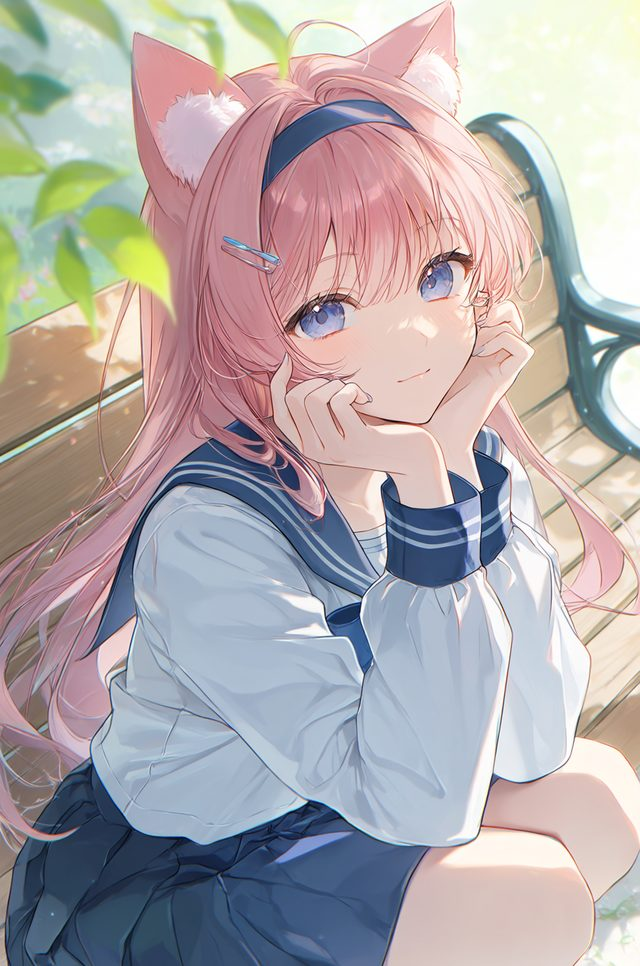

- **Features**: Officially recommended; multi-character scenes, lighting, dynamic poses, and prompt adherence; kit default
- **Appearance**: pink hair, close-up resting chin on hand, bright anime coloring
- **Type**: DiT (MMDIT26A_MODEL)
- **mode**: standard
- **Generation time**: ~21s
- **CLI Flag**: `--model tsubaki2` / modelVersionId `1983308862240288769`

<details>
<summary>Prompt Details</summary>

```text
1girl, solo, cat ears, serafuku, park, masterpiece, best quality
Negative: text, speech bubble, panel border, watermark
seed: 20261025
mode: standard
```

</details>

---

## Tsubaki

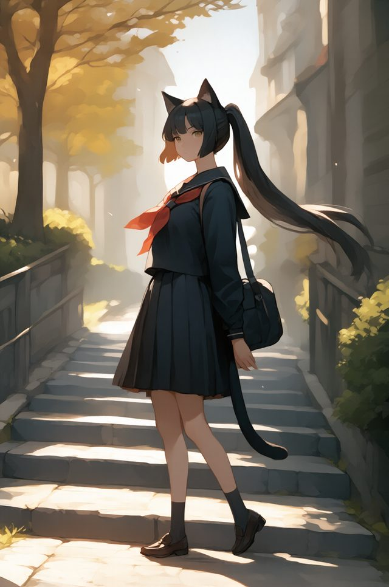

- **Features**: First-generation DiT; multi-character and natural-language prompts; mode and style presets are officially supported only on Tsubaki.2 and Tsubaki.3 families
- **Appearance**: black hair, full-body looking back on backlit stairs, background closer to a street than a park
- **Type**: DiT (DIT7B_MODEL)
- **mode**: none
- **Generation time**: ~72s
- **CLI Flag**: `--model tsubaki` / modelVersionId `1894092844569363483`

<details>
<summary>Prompt Details</summary>

```text
1girl, solo, cat ears, serafuku, park, masterpiece, best quality
Negative: text, speech bubble, panel border, watermark
seed: 20261025
```

</details>

---

## Tsubaki v1.1

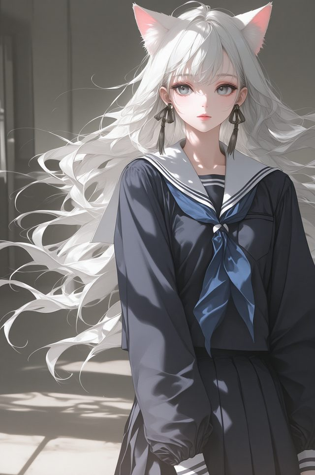

- **Features**: Improved version of Tsubaki; high resolution and multiple characters
- **Appearance**: white hair, muted-tone upper body, park background barely visible
- **Type**: DiT (DIT7B_MODEL)
- **mode**: none
- **Generation time**: ~30s
- **CLI Flag**: `--model tsubaki-v1-1` / modelVersionId `1935090615918113018`

<details>
<summary>Prompt Details</summary>

```text
1girl, solo, cat ears, serafuku, park, masterpiece, best quality
Negative: text, speech bubble, panel border, watermark
seed: 20261025
```

</details>

---

## Tsubaki Flash

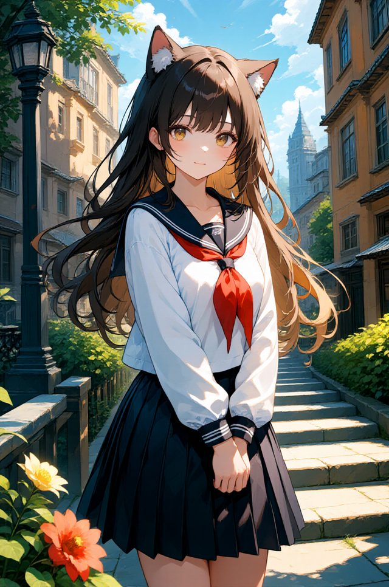

- **Features**: Fast version of Tsubaki
- **Appearance**: long black hair, flowers, stairs, and buildings; background looks more like a cityscape than a park
- **Type**: DiT (DIT7B_MODEL)
- **mode**: none
- **Generation time**: ~41s
- **CLI Flag**: `--model tsubaki-flash` / modelVersionId `1934789864939078594`

<details>
<summary>Prompt Details</summary>

```text
1girl, solo, cat ears, serafuku, park, masterpiece, best quality
Negative: text, speech bubble, panel border, watermark
seed: 20261025
```

</details>

---

## Serin

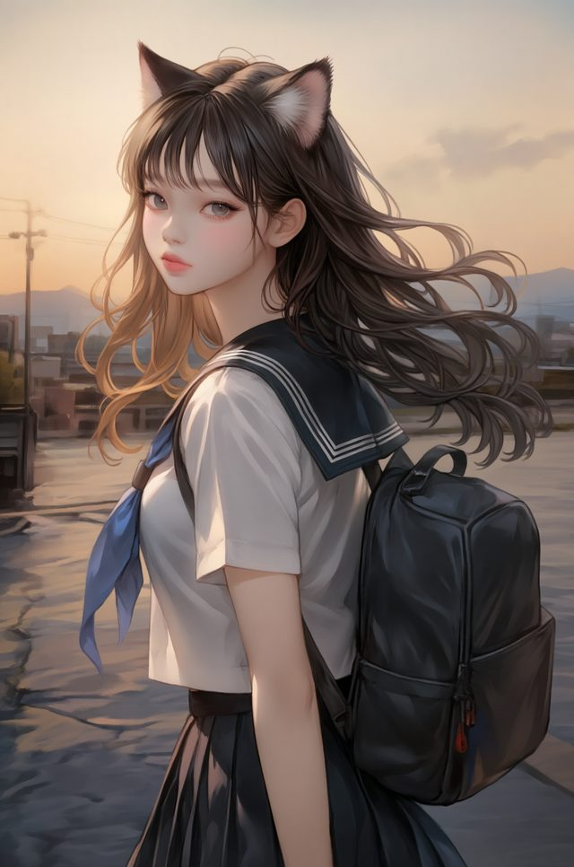

- **Features**: Korean webtoon and fashion style
- **Appearance**: semi-realistic face, evening street, park background did not appear
- **Type**: DiT (DIT7B_MODEL)
- **mode**: none
- **Generation time**: ~30s
- **CLI Flag**: `--model serin` / modelVersionId `1914519679917387494`

<details>
<summary>Prompt Details</summary>

```text
1girl, solo, cat ears, serafuku, park, masterpiece, best quality
Negative: text, speech bubble, panel border, watermark
seed: 20261025
```

</details>

---

## Haruka v2

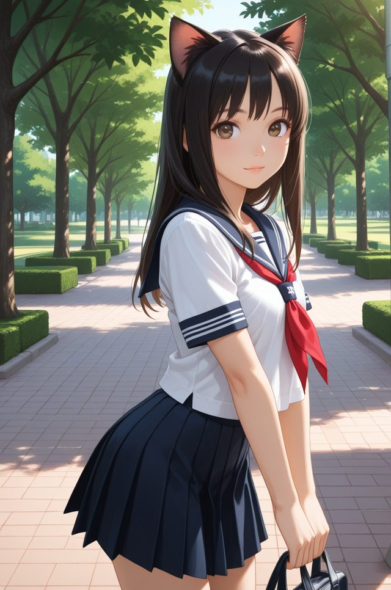

- **Features**: Officially recommended; stable coloring, accurate hands, and high resolution; most frequently used model
- **Appearance**: black hair, tree-lined park, crisp anime coloring
- **Type**: SDXL (SDXL_MODEL)
- **mode**: none
- **Generation time**: ~51s
- **CLI Flag**: `--model haruka2` / modelVersionId `1861558740588989558`

<details>
<summary>Prompt Details</summary>

```text
1girl, solo, cat ears, serafuku, park, masterpiece, best quality
Negative: text, speech bubble, panel border, watermark
seed: 20261025
```

</details>

---

## Haruka


- **Features**: Earlier version before Haruka v2
- **Appearance**: black hair, tree-lined park, flat anime coloring
- **Type**: SDXL (SDXL_MODEL)
- **mode**: none
- **Generation time**: ~15s
- **CLI Flag**: `--model haruka` / modelVersionId `1805666669332128958`

<details>
<summary>Prompt Details</summary>

```text
1girl, solo, cat ears, serafuku, park, masterpiece, best quality
Negative: text, speech bubble, panel border, watermark
seed: 20261025
```

</details>

---

## Hoshino v2

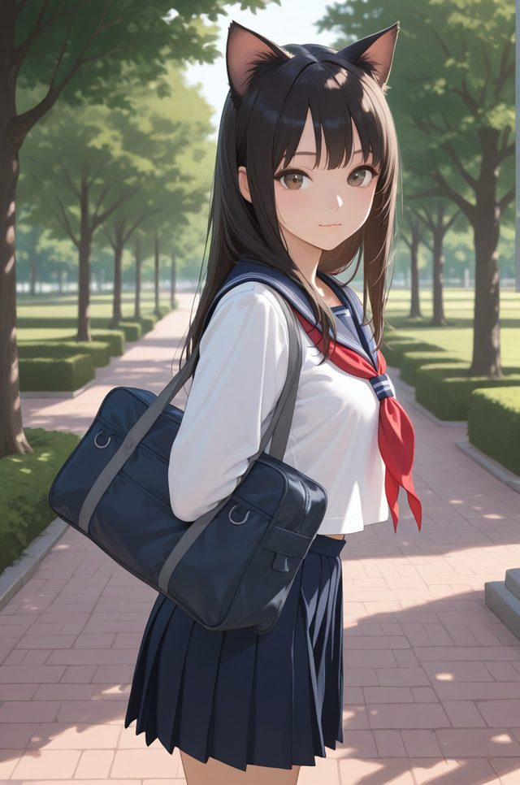

- **Features**: Officially recommended; popular Japanese aesthetic, retro anime feel, and accurate hands
- **Appearance**: black hair, tree-lined park, school bag, crisp anime coloring
- **Type**: SDXL (SDXL_MODEL)
- **mode**: none
- **Generation time**: ~21s
- **CLI Flag**: `--model hoshino2` / modelVersionId `1954632828118619567`

<details>
<summary>Prompt Details</summary>

```text
1girl, solo, cat ears, serafuku, park, masterpiece, best quality
Negative: text, speech bubble, panel border, watermark
seed: 20261025
```

</details>

---

## Otome v2


- **Features**: Tuned for male characters
- **Appearance**: black hair, tree-lined park, slightly older anime look
- **Type**: SDXL (SDXL_MODEL)
- **mode**: none
- **Generation time**: ~41s
- **CLI Flag**: `--model otome2` / modelVersionId `1856956435031440023`

<details>
<summary>Prompt Details</summary>

```text
1girl, solo, cat ears, serafuku, park, masterpiece, best quality
Negative: text, speech bubble, panel border, watermark
seed: 20261025
```

</details>

---

## Hinata v2


- **Features**: Tuned for style reproduction and short prompts
- **Appearance**: slightly stylized proportions, park with playground equipment, softly blended background
- **Type**: SDXL (SDXL_MODEL)
- **mode**: none
- **Generation time**: ~30s
- **CLI Flag**: `--model hinata2` / modelVersionId `1869108561160475178`

<details>
<summary>Prompt Details</summary>

```text
1girl, solo, cat ears, serafuku, park, masterpiece, best quality
Negative: text, speech bubble, panel border, watermark
seed: 20261025
```

</details>

---

## Nagi


- **Features**: Tuned for style reproduction
- **Appearance**: short black hair, cat pose, bold-lined illustration look
- **Type**: SDXL (SDXL_MODEL)
- **mode**: none
- **Generation time**: ~30s
- **CLI Flag**: `--model nagi` / modelVersionId `1961253301321929990`

<details>
<summary>Prompt Details</summary>

```text
1girl, solo, cat ears, serafuku, park, masterpiece, best quality
Negative: text, speech bubble, panel border, watermark
seed: 20261025
```

</details>

---

## Crystalize


- **Features**: Tuned for style reproduction
- **Appearance**: black hair, leaning hands on a desk, prominent linework illustration look
- **Type**: SDXL (SDXL_MODEL)
- **mode**: none
- **Generation time**: ~71s
- **CLI Flag**: `--model crystalize` / modelVersionId `1964824608626653146`

<details>
<summary>Prompt Details</summary>

```text
1girl, solo, cat ears, serafuku, park, masterpiece, best quality
Negative: text, speech bubble, panel border, watermark
seed: 20261025
```

</details>

---

## Eternal


- **Features**: Tuned for style reproduction
- **Appearance**: brown hair, indoor room with a window (park background did not appear), thicker painterly shading
- **Type**: SDXL (SDXL_MODEL)
- **mode**: none
- **Generation time**: ~41s
- **CLI Flag**: `--model eternal` / modelVersionId `1965302325944495788`

<details>
<summary>Prompt Details</summary>

```text
1girl, solo, cat ears, serafuku, park, masterpiece, best quality
Negative: text, speech bubble, panel border, watermark
seed: 20261025
```

</details>

---

## Watercolor Glow (anime-watercolor-impasto)

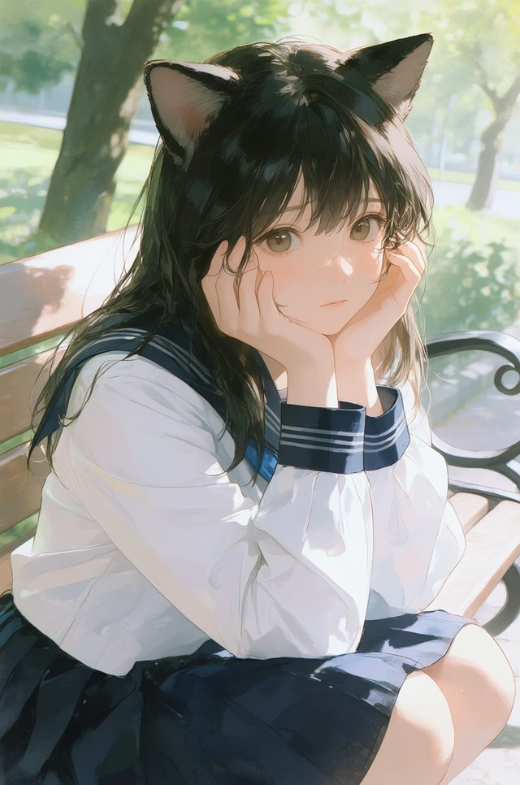

- **Type**: Style preset (effective only on Tsubaki.2 and Tsubaki.3 families)
- **Sample model**: Tsubaki.2
- **mode**: standard
- **CLI Flag**: `--style-preset anime-watercolor-impasto` (combine with `--model tsubaki2`, `tsubaki3`, etc.)

<details>
<summary>Prompt Details</summary>

```text
1girl, solo, cat ears, serafuku, park, masterpiece, best quality
Negative: text, speech bubble, panel border, watermark
seed: 20261025
mode: standard
```

</details>

---

## Art Crayon (art-crayon)

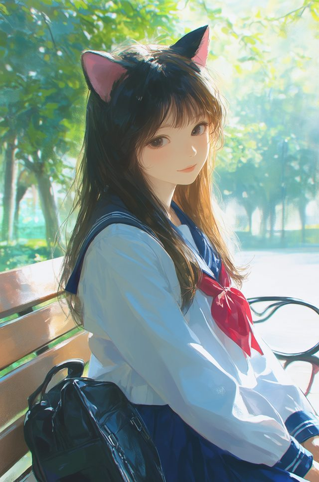

- **Type**: Style preset (effective only on Tsubaki.2 and Tsubaki.3 families)
- **Sample model**: Tsubaki.2
- **mode**: standard
- **CLI Flag**: `--style-preset art-crayon` (combine with `--model tsubaki2`, `tsubaki3`, etc.)

<details>
<summary>Prompt Details</summary>

```text
1girl, solo, cat ears, serafuku, park, masterpiece, best quality
Negative: text, speech bubble, panel border, watermark
seed: 20261025
mode: standard
```

</details>

---

## Glint & Gloom (bold-line-soft-color)

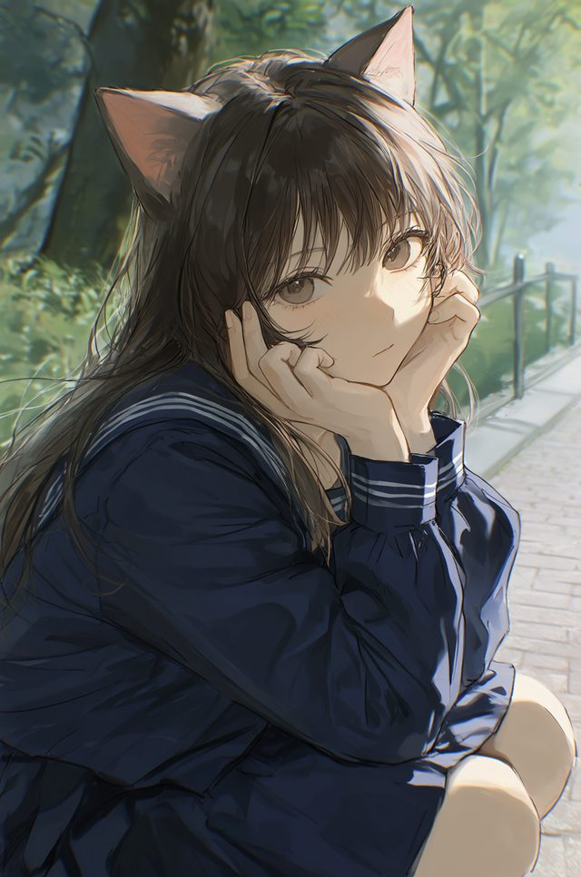

- **Type**: Style preset (effective only on Tsubaki.2 and Tsubaki.3 families)
- **Sample model**: Tsubaki.2
- **mode**: standard
- **CLI Flag**: `--style-preset bold-line-soft-color` (combine with `--model tsubaki2`, `tsubaki3`, etc.)

<details>
<summary>Prompt Details</summary>

```text
1girl, solo, cat ears, serafuku, park, masterpiece, best quality
Negative: text, speech bubble, panel border, watermark
seed: 20261025
mode: standard
```

</details>

---

## Chibi (chibi)


- **Type**: Style preset (effective only on Tsubaki.2 and Tsubaki.3 families)
- **Sample model**: Tsubaki.2
- **mode**: standard
- **CLI Flag**: `--style-preset chibi` (combine with `--model tsubaki2`, `tsubaki3`, etc.)

<details>
<summary>Prompt Details</summary>

```text
1girl, solo, cat ears, serafuku, park, masterpiece, best quality
Negative: text, speech bubble, panel border, watermark
seed: 20261025
mode: standard
```

</details>

---

## Classic Anime (classic-japanese)

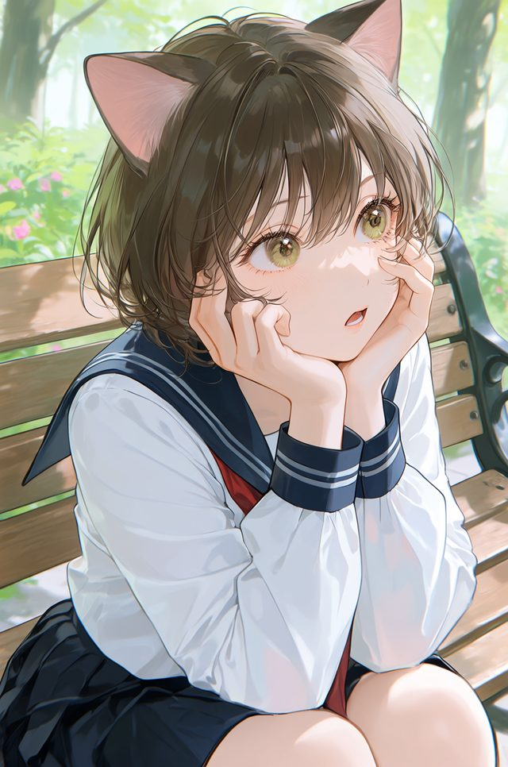

- **Type**: Style preset (effective only on Tsubaki.2 and Tsubaki.3 families)
- **Sample model**: Tsubaki.2
- **mode**: standard
- **CLI Flag**: `--style-preset classic-japanese` (combine with `--model tsubaki2`, `tsubaki3`, etc.)

<details>
<summary>Prompt Details</summary>

```text
1girl, solo, cat ears, serafuku, park, masterpiece, best quality
Negative: text, speech bubble, panel border, watermark
seed: 20261025
mode: standard
```

</details>

---

## Clean Flat-Illustration (clean-flat-illustration)

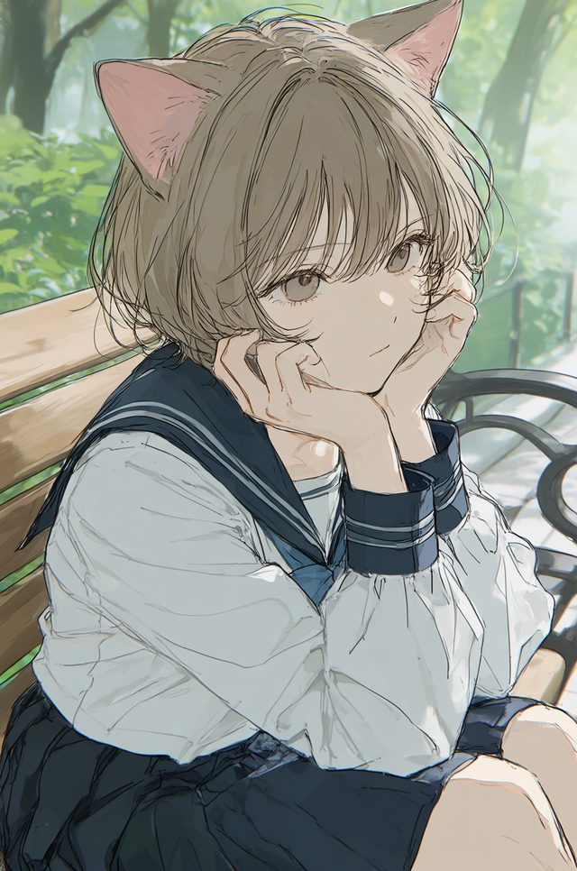

- **Type**: Style preset (effective only on Tsubaki.2 and Tsubaki.3 families)
- **Sample model**: Tsubaki.2
- **mode**: standard
- **CLI Flag**: `--style-preset clean-flat-illustration` (combine with `--model tsubaki2`, `tsubaki3`, etc.)

<details>
<summary>Prompt Details</summary>

```text
1girl, solo, cat ears, serafuku, park, masterpiece, best quality
Negative: text, speech bubble, panel border, watermark
seed: 20261025
mode: standard
```

</details>

---

## Chromatic Pencil (colored-pencil-grain)


- **Type**: Style preset (effective only on Tsubaki.2 and Tsubaki.3 families)
- **Sample model**: Tsubaki.2
- **mode**: standard
- **CLI Flag**: `--style-preset colored-pencil-grain` (combine with `--model tsubaki2`, `tsubaki3`, etc.)

<details>
<summary>Prompt Details</summary>

```text
1girl, solo, cat ears, serafuku, park, masterpiece, best quality
Negative: text, speech bubble, panel border, watermark
seed: 20261025
mode: standard
```

</details>

---

## Seasonal Glow (cool-warm-oil-contrast)


- **Type**: Style preset (effective only on Tsubaki.2 and Tsubaki.3 families)
- **Sample model**: Tsubaki.2
- **mode**: standard
- **CLI Flag**: `--style-preset cool-warm-oil-contrast` (combine with `--model tsubaki2`, `tsubaki3`, etc.)

<details>
<summary>Prompt Details</summary>

```text
1girl, solo, cat ears, serafuku, park, masterpiece, best quality
Negative: text, speech bubble, panel border, watermark
seed: 20261025
mode: standard
```

</details>

---

## Cool Softlight (desaturated-cool)

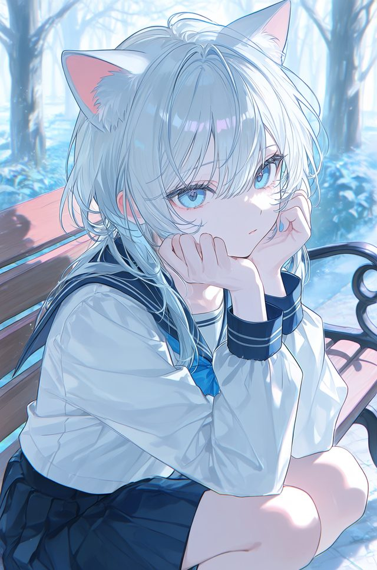

- **Type**: Style preset (effective only on Tsubaki.2 and Tsubaki.3 families)
- **Sample model**: Tsubaki.2
- **mode**: standard
- **CLI Flag**: `--style-preset desaturated-cool` (combine with `--model tsubaki2`, `tsubaki3`, etc.)

<details>
<summary>Prompt Details</summary>

```text
1girl, solo, cat ears, serafuku, park, masterpiece, best quality
Negative: text, speech bubble, panel border, watermark
seed: 20261025
mode: standard
```

</details>

---

## Pastel Flat (flat-anime-pastel)

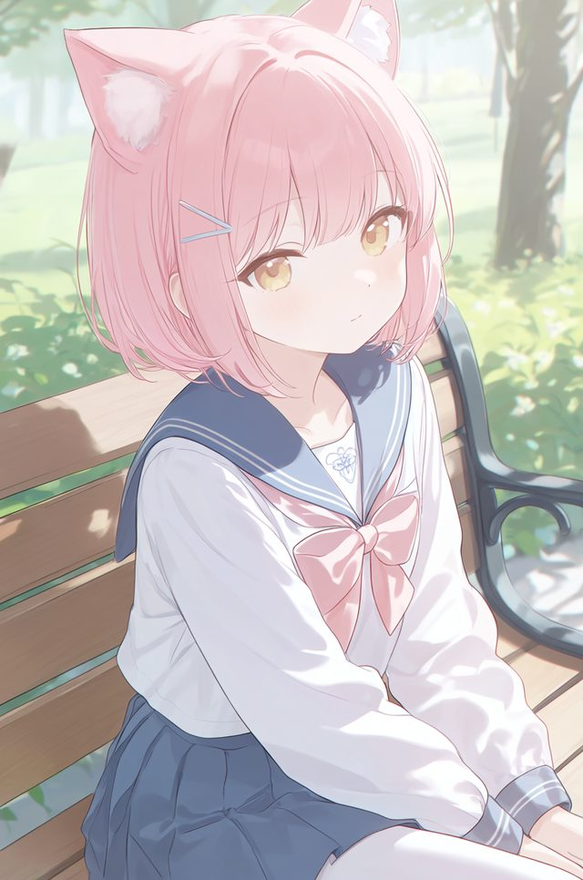

- **Type**: Style preset (effective only on Tsubaki.2 and Tsubaki.3 families)
- **Sample model**: Tsubaki.2
- **mode**: standard
- **CLI Flag**: `--style-preset flat-anime-pastel` (combine with `--model tsubaki2`, `tsubaki3`, etc.)
- **Note**: This preset tends to draw an unprompted ring above the head even when halo is in the negative prompt; the sample image had that ring removed via inpainting.

<details>
<summary>Prompt Details</summary>

```text
1girl, solo, cat ears, serafuku, park, masterpiece, best quality
Negative: text, speech bubble, panel border, watermark, halo
seed: 657280891
mode: standard
```

</details>

---

## Glassy Anime (glossy-glass-anime)


- **Type**: Style preset (effective only on Tsubaki.2 and Tsubaki.3 families)
- **Sample model**: Tsubaki.2
- **mode**: standard
- **CLI Flag**: `--style-preset glossy-glass-anime` (combine with `--model tsubaki2`, `tsubaki3`, etc.)

<details>
<summary>Prompt Details</summary>

```text
1girl, solo, cat ears, serafuku, park, masterpiece, best quality
Negative: text, speech bubble, panel border, watermark
seed: 20261025
mode: standard
```

</details>

---

## Grey Wash (grey-blocks-lineless)


- **Type**: Style preset (effective only on Tsubaki.2 and Tsubaki.3 families)
- **Sample model**: Tsubaki.2
- **mode**: standard
- **CLI Flag**: `--style-preset grey-blocks-lineless` (combine with `--model tsubaki2`, `tsubaki3`, etc.)

<details>
<summary>Prompt Details</summary>

```text
1girl, solo, cat ears, serafuku, park, masterpiece, best quality
Negative: text, speech bubble, panel border, watermark
seed: 20261025
mode: standard
```

</details>

---

## Sharp Ink (hard-line-monochrome-accent)

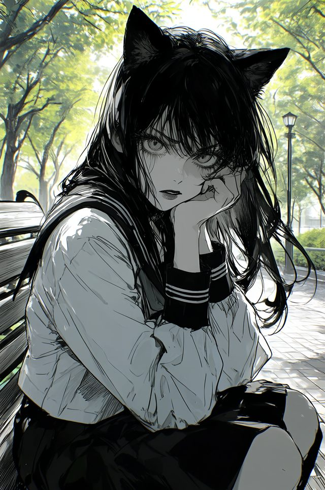

- **Type**: Style preset (effective only on Tsubaki.2 and Tsubaki.3 families)
- **Sample model**: Tsubaki.2
- **mode**: standard
- **CLI Flag**: `--style-preset hard-line-monochrome-accent` (combine with `--model tsubaki2`, `tsubaki3`, etc.)

<details>
<summary>Prompt Details</summary>

```text
1girl, solo, cat ears, serafuku, park, masterpiece, best quality
Negative: text, speech bubble, panel border, watermark
seed: 20261025
mode: standard
```

</details>

---

## Neon Vivid (high-contrast-retro-vivid)

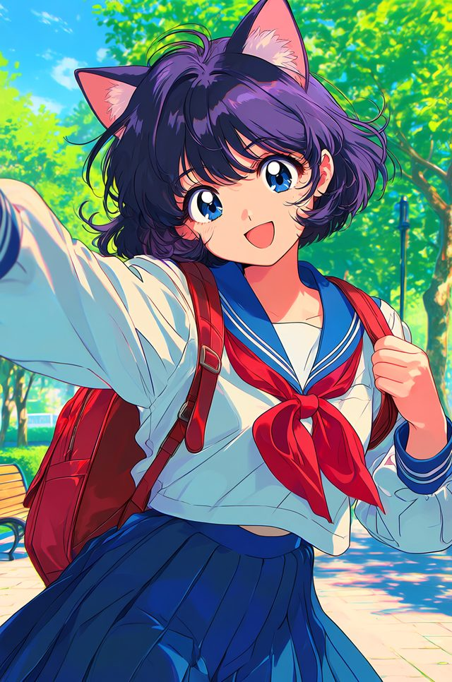

- **Type**: Style preset (effective only on Tsubaki.2 and Tsubaki.3 families)
- **Sample model**: Tsubaki.2
- **mode**: standard
- **CLI Flag**: `--style-preset high-contrast-retro-vivid` (combine with `--model tsubaki2`, `tsubaki3`, etc.)

<details>
<summary>Prompt Details</summary>

```text
1girl, solo, cat ears, serafuku, park, masterpiece, best quality
Negative: text, speech bubble, panel border, watermark
seed: 20261025
mode: standard
```

</details>

---

## Hyper Pop (holographic)

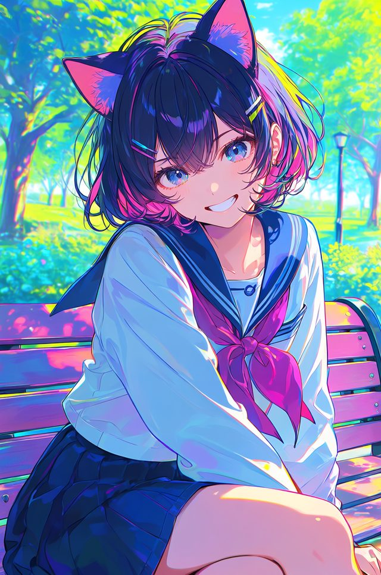

- **Type**: Style preset (effective only on Tsubaki.2 and Tsubaki.3 families)
- **Sample model**: Tsubaki.2
- **mode**: standard
- **CLI Flag**: `--style-preset holographic` (combine with `--model tsubaki2`, `tsubaki3`, etc.)

<details>
<summary>Prompt Details</summary>

```text
1girl, solo, cat ears, serafuku, park, masterpiece, best quality
Negative: text, speech bubble, panel border, watermark
seed: 20261025
mode: standard
```

</details>

---

## Polished Manhwa (korean-style)

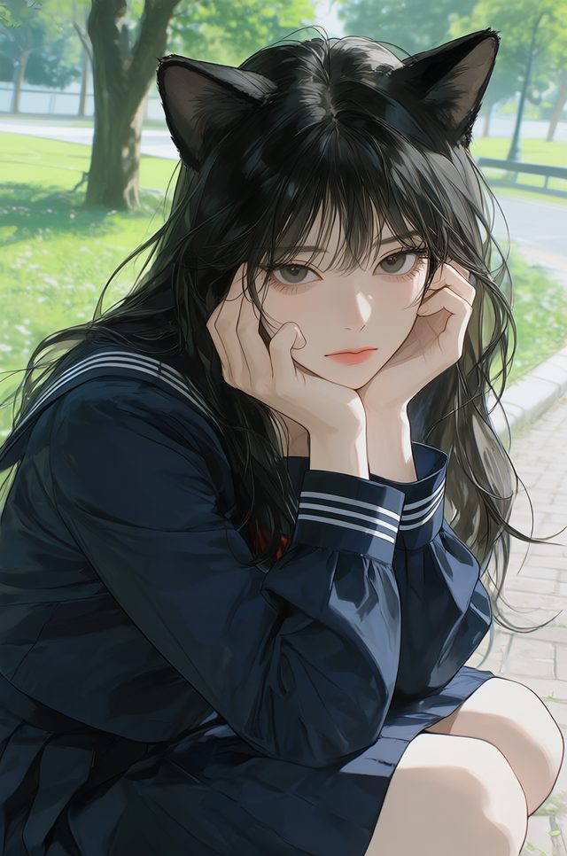

- **Type**: Style preset (effective only on Tsubaki.2 and Tsubaki.3 families)
- **Sample model**: Tsubaki.2
- **mode**: standard
- **CLI Flag**: `--style-preset korean-style` (combine with `--model tsubaki2`, `tsubaki3`, etc.)

<details>
<summary>Prompt Details</summary>

```text
1girl, solo, cat ears, serafuku, park, masterpiece, best quality
Negative: text, speech bubble, panel border, watermark
seed: 20261025
mode: standard
```

</details>

---

## Luminous Wash (lineart-watercolor-airy)

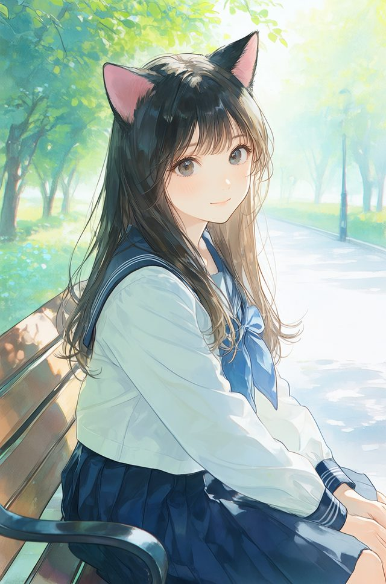

- **Type**: Style preset (effective only on Tsubaki.2 and Tsubaki.3 families)
- **Sample model**: Tsubaki.2
- **mode**: standard
- **CLI Flag**: `--style-preset lineart-watercolor-airy` (combine with `--model tsubaki2`, `tsubaki3`, etc.)

<details>
<summary>Prompt Details</summary>

```text
1girl, solo, cat ears, serafuku, park, masterpiece, best quality
Negative: text, speech bubble, panel border, watermark
seed: 20261025
mode: standard
```

</details>

---

## Muted & Transparent (low-saturation-expressive-eyes)

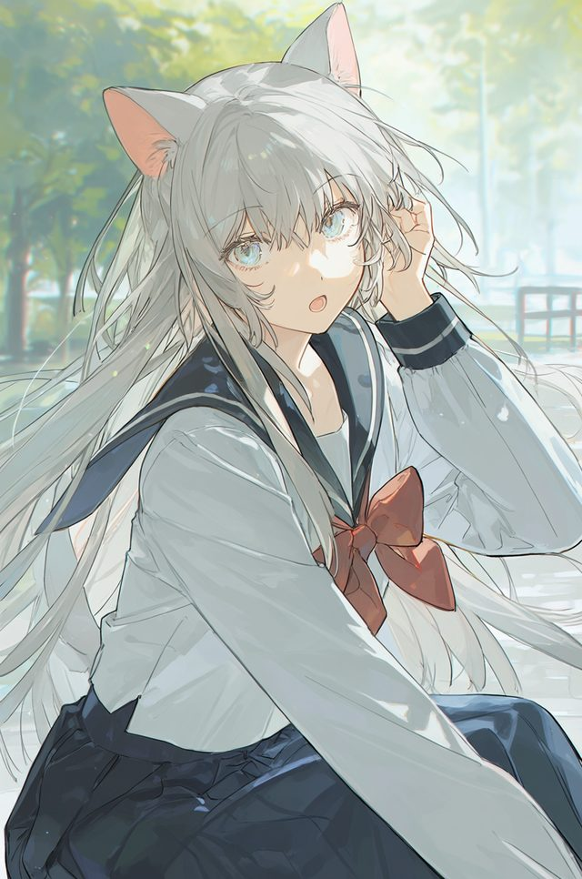

- **Type**: Style preset (effective only on Tsubaki.2 and Tsubaki.3 families)
- **Sample model**: Tsubaki.2
- **mode**: standard
- **CLI Flag**: `--style-preset low-saturation-expressive-eyes` (combine with `--model tsubaki2`, `tsubaki3`, etc.)

<details>
<summary>Prompt Details</summary>

```text
1girl, solo, cat ears, serafuku, park, masterpiece, best quality
Negative: text, speech bubble, panel border, watermark
seed: 20261025
mode: standard
```

</details>

---

## Lucid Dreamy (lucid-dreamy)


- **Type**: Style preset (effective only on Tsubaki.2 and Tsubaki.3 families)
- **Sample model**: Tsubaki.2
- **mode**: standard
- **CLI Flag**: `--style-preset lucid-dreamy` (combine with `--model tsubaki2`, `tsubaki3`, etc.)

<details>
<summary>Prompt Details</summary>

```text
1girl, solo, cat ears, serafuku, park, masterpiece, best quality
Negative: text, speech bubble, panel border, watermark
seed: 20261025
mode: standard
```

</details>

---

## Luminous Impasto (luminous-retro-impasto)

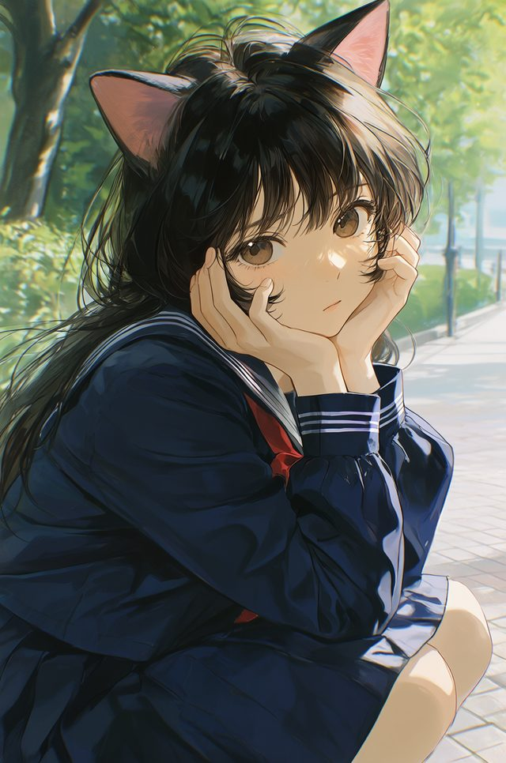

- **Type**: Style preset (effective only on Tsubaki.2 and Tsubaki.3 families)
- **Sample model**: Tsubaki.2
- **mode**: standard
- **CLI Flag**: `--style-preset luminous-retro-impasto` (combine with `--model tsubaki2`, `tsubaki3`, etc.)

<details>
<summary>Prompt Details</summary>

```text
1girl, solo, cat ears, serafuku, park, masterpiece, best quality
Negative: text, speech bubble, panel border, watermark
seed: 20261025
mode: standard
```

</details>

---

## Minimal Flat (minimal-flat-color)

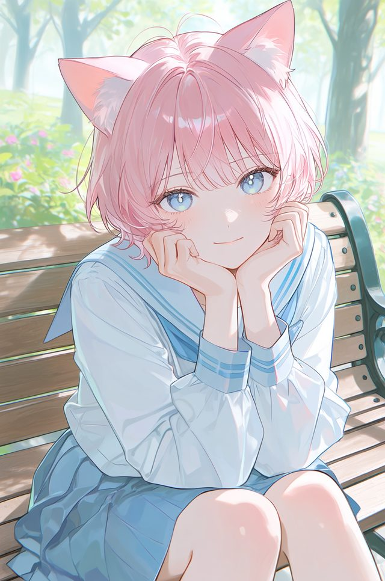

- **Type**: Style preset (effective only on Tsubaki.2 and Tsubaki.3 families)
- **Sample model**: Tsubaki.2
- **mode**: standard
- **CLI Flag**: `--style-preset minimal-flat-color` (combine with `--model tsubaki2`, `tsubaki3`, etc.)

<details>
<summary>Prompt Details</summary>

```text
1girl, solo, cat ears, serafuku, park, masterpiece, best quality
Negative: text, speech bubble, panel border, watermark
seed: 20261025
mode: standard
```

</details>

---

## Modern Glam Anime (modern-oil-glamour)

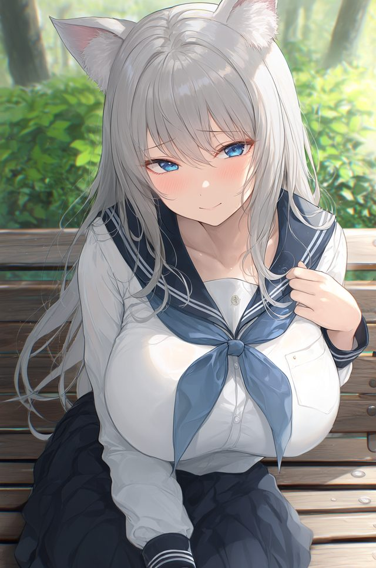

- **Type**: Style preset (effective only on Tsubaki.2 and Tsubaki.3 families)
- **Sample model**: Tsubaki.2
- **mode**: standard
- **CLI Flag**: `--style-preset modern-oil-glamour` (combine with `--model tsubaki2`, `tsubaki3`, etc.)

<details>
<summary>Prompt Details</summary>

```text
1girl, solo, cat ears, serafuku, park, masterpiece, best quality
Negative: text, speech bubble, panel border, watermark
seed: 20261025
mode: standard
```

</details>

---

## Moe Pastel (moe-pastel)


- **Type**: Style preset (effective only on Tsubaki.2 and Tsubaki.3 families)
- **Sample model**: Tsubaki.2
- **mode**: standard
- **CLI Flag**: `--style-preset moe-pastel` (combine with `--model tsubaki2`, `tsubaki3`, etc.)

<details>
<summary>Prompt Details</summary>

```text
1girl, solo, cat ears, serafuku, park, masterpiece, best quality
Negative: text, speech bubble, panel border, watermark
seed: 20261025
mode: standard
```

</details>

---

## Water-Infused Oil (oil-watercolor-blend)


- **Type**: Style preset (effective only on Tsubaki.2 and Tsubaki.3 families)
- **Sample model**: Tsubaki.2
- **mode**: standard
- **CLI Flag**: `--style-preset oil-watercolor-blend` (combine with `--model tsubaki2`, `tsubaki3`, etc.)

<details>
<summary>Prompt Details</summary>

```text
1girl, solo, cat ears, serafuku, park, masterpiece, best quality
Negative: text, speech bubble, panel border, watermark
seed: 20261025
mode: standard
```

</details>

---

## Tender Brushstroke (painterly-doodle)

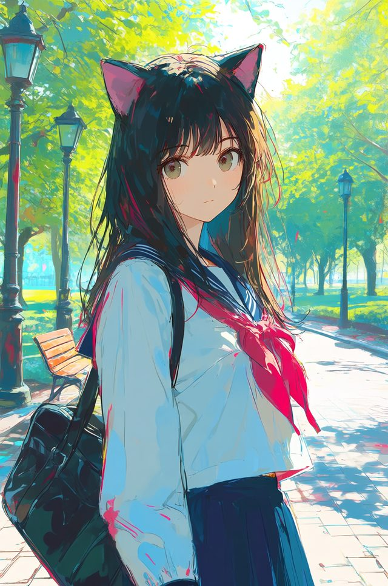

- **Type**: Style preset (effective only on Tsubaki.2 and Tsubaki.3 families)
- **Sample model**: Tsubaki.2
- **mode**: standard
- **CLI Flag**: `--style-preset painterly-doodle` (combine with `--model tsubaki2`, `tsubaki3`, etc.)

<details>
<summary>Prompt Details</summary>

```text
1girl, solo, cat ears, serafuku, park, masterpiece, best quality
Negative: text, speech bubble, panel border, watermark
seed: 20261025
mode: standard
```

</details>

---

## Soft Aqueous (paper-watercolor)


- **Type**: Style preset (effective only on Tsubaki.2 and Tsubaki.3 families)
- **Sample model**: Tsubaki.2
- **mode**: standard
- **CLI Flag**: `--style-preset paper-watercolor` (combine with `--model tsubaki2`, `tsubaki3`, etc.)

<details>
<summary>Prompt Details</summary>

```text
1girl, solo, cat ears, serafuku, park, masterpiece, best quality
Negative: text, speech bubble, panel border, watermark
seed: 20261025
mode: standard
```

</details>

---

## Pencil Sketch (pencil-sketch)

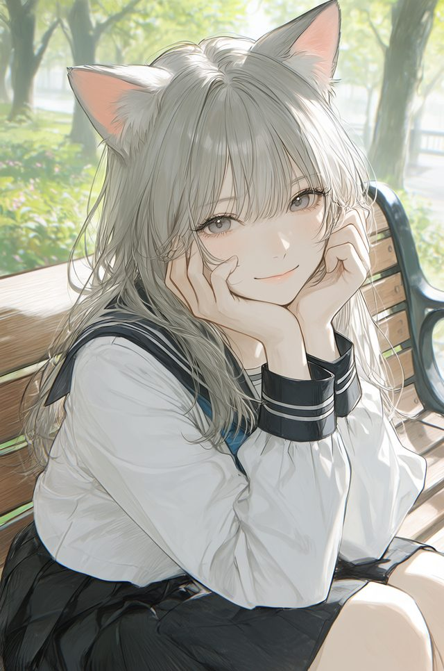

- **Type**: Style preset (effective only on Tsubaki.2 and Tsubaki.3 families)
- **Sample model**: Tsubaki.2
- **mode**: standard
- **CLI Flag**: `--style-preset pencil-sketch` (combine with `--model tsubaki2`, `tsubaki3`, etc.)

<details>
<summary>Prompt Details</summary>

```text
1girl, solo, cat ears, serafuku, park, masterpiece, best quality
Negative: text, speech bubble, panel border, watermark
seed: 20261025
mode: standard
```

</details>

---

## Neon Poster (poster-graffiti)


- **Type**: Style preset (effective only on Tsubaki.2 and Tsubaki.3 families)
- **Sample model**: Tsubaki.2
- **mode**: standard
- **CLI Flag**: `--style-preset poster-graffiti` (combine with `--model tsubaki2`, `tsubaki3`, etc.)

<details>
<summary>Prompt Details</summary>

```text
1girl, solo, cat ears, serafuku, park, masterpiece, best quality
Negative: text, speech bubble, panel border, watermark
seed: 20261025
mode: standard
```

</details>

---

## Retro Fusion (retro-comic-fusion)


- **Type**: Style preset (effective only on Tsubaki.2 and Tsubaki.3 families)
- **Sample model**: Tsubaki.2
- **mode**: standard
- **CLI Flag**: `--style-preset retro-comic-fusion` (combine with `--model tsubaki2`, `tsubaki3`, etc.)

<details>
<summary>Prompt Details</summary>

```text
1girl, solo, cat ears, serafuku, park, masterpiece, best quality
Negative: text, speech bubble, panel border, watermark
seed: 20261025
mode: standard
```

</details>

---

## Retro Glam Anime (retro-oil-glamour)

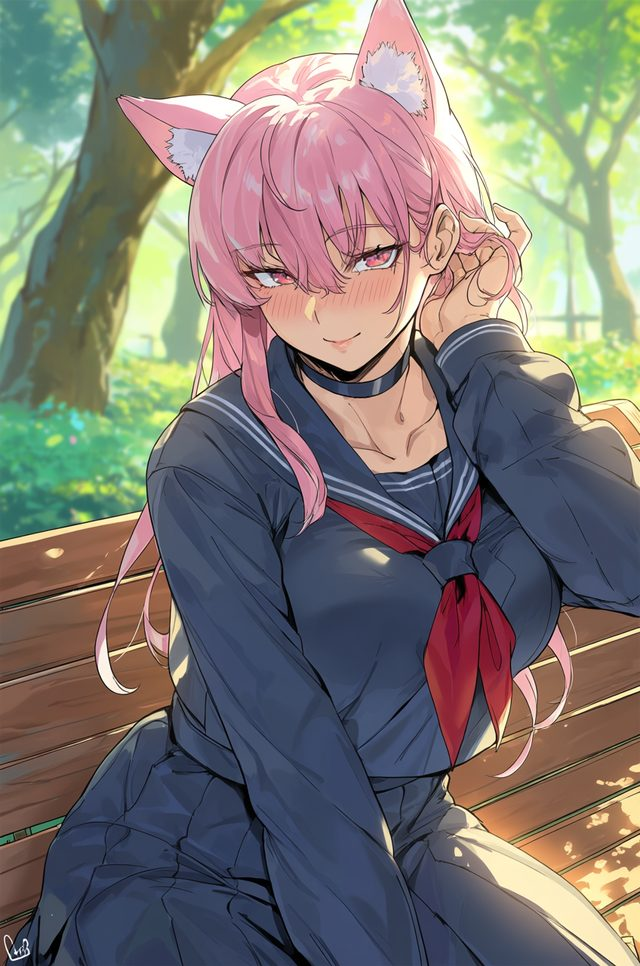

- **Type**: Style preset (effective only on Tsubaki.2 and Tsubaki.3 families)
- **Sample model**: Tsubaki.2
- **mode**: standard
- **CLI Flag**: `--style-preset retro-oil-glamour` (combine with `--model tsubaki2`, `tsubaki3`, etc.)

<details>
<summary>Prompt Details</summary>

```text
1girl, solo, cat ears, serafuku, park, masterpiece, best quality
Negative: text, speech bubble, panel border, watermark
seed: 20261025
mode: standard
```

</details>

---

## 90s Retro-Cell (retro-tv-anime)


- **Type**: Style preset (effective only on Tsubaki.2 and Tsubaki.3 families)
- **Sample model**: Tsubaki.2
- **mode**: standard
- **CLI Flag**: `--style-preset retro-tv-anime` (combine with `--model tsubaki2`, `tsubaki3`, etc.)

<details>
<summary>Prompt Details</summary>

```text
1girl, solo, cat ears, serafuku, park, masterpiece, best quality
Negative: text, speech bubble, panel border, watermark
seed: 20261025
mode: standard
```

</details>

---

## Semi-Real (semi-realistic)

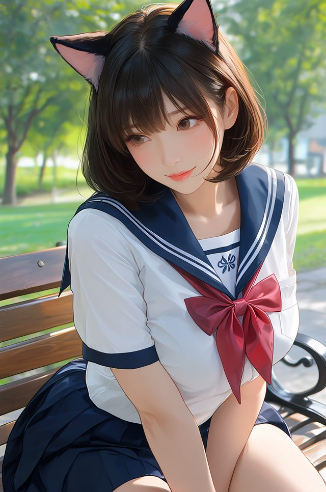

- **Type**: Style preset (effective only on Tsubaki.2 and Tsubaki.3 families)
- **Sample model**: Tsubaki.2
- **mode**: standard
- **CLI Flag**: `--style-preset semi-realistic` (combine with `--model tsubaki2`, `tsubaki3`, etc.)

<details>
<summary>Prompt Details</summary>

```text
1girl, solo, cat ears, serafuku, park, masterpiece, best quality
Negative: text, speech bubble, panel border, watermark
seed: 20261025
mode: standard
```

</details>

---

## Neon Vaporwave (stable-vaporwave)


- **Type**: Style preset (effective only on Tsubaki.2 and Tsubaki.3 families)
- **Sample model**: Tsubaki.2
- **mode**: standard
- **CLI Flag**: `--style-preset stable-vaporwave` (combine with `--model tsubaki2`, `tsubaki3`, etc.)

<details>
<summary>Prompt Details</summary>

```text
1girl, solo, cat ears, serafuku, park, masterpiece, best quality
Negative: text, speech bubble, panel border, watermark
seed: 20261025
mode: standard
```

</details>

---

## Tinted Sketch (tinted-sketch)


- **Type**: Style preset (effective only on Tsubaki.2 and Tsubaki.3 families)
- **Sample model**: Tsubaki.2
- **mode**: standard
- **CLI Flag**: `--style-preset tinted-sketch` (combine with `--model tsubaki2`, `tsubaki3`, etc.)

<details>
<summary>Prompt Details</summary>

```text
1girl, solo, cat ears, serafuku, park, masterpiece, best quality
Negative: text, speech bubble, panel border, watermark
seed: 20261025
mode: standard
```

</details>

---

## Vintage Collage (vintage-collage)

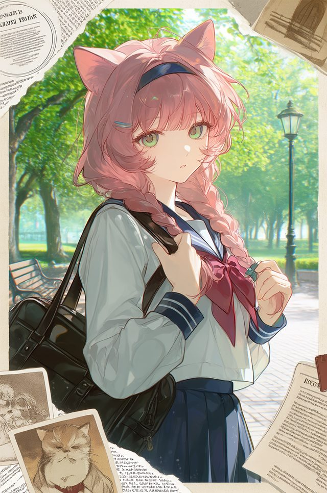

- **Type**: Style preset (effective only on Tsubaki.2 and Tsubaki.3 families)
- **Sample model**: Tsubaki.2
- **mode**: standard
- **CLI Flag**: `--style-preset vintage-collage` (combine with `--model tsubaki2`, `tsubaki3`, etc.)

<details>
<summary>Prompt Details</summary>

```text
1girl, solo, cat ears, serafuku, park, masterpiece, best quality
Negative: text, speech bubble, panel border, watermark
seed: 20261025
mode: standard
```

</details>
