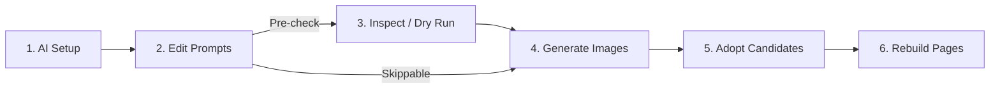

# Edit and Regenerate NovelAI Characters, Styles, and Backgrounds

This guide explains how to change character appearances, art styles, and backgrounds, regenerate images, and rebuild pages in a **project where NovelAI prompt assembly is already complete** or **where manga PNG previews are already finished**. Work inside the existing project folder.

By editing `.env.novelai` or the editing text files inside the project folder, you can replace shared parts of your prompts (character hairstyles and clothing, art style, backgrounds, and more) in bulk.

> [!NOTE]
> Settings files are split into three files: `.env` is for shared settings such as API keys and URLs, `.env.novelai` is for NovelAI (the file edited in this guide), and `.env.pixai` is for PixAI. In projects created with an earlier version where NovelAI variables were placed in `.env`, the script will instruct you to migrate them. Run `python -X utf8 scripts/novelai_batch.py env-migrate` to move them to `.env.novelai` (API key lines and other settings remain in `.env`; use `--dry-run` to preview only).

> [!NOTE]
> This workflow standardizes on **asking an AI agent (Codex, Claude Code, Antigravity, etc.) to prepare and inspect the environment while you decide what to change**.
> At each stage, you can either run commands yourself from a terminal or ask the AI agent to run them for you. Asking for preparation alone does not authorize image generation or paid usage.

---

## [Quick Start] Change Only a Character's Appearance

Use this shortest path when you want to quickly change a character's appearance.
**Ask the AI agent to prepare the environment only the first time**; from the second time onward, you only need **Step 1 through Step 4**.

### [First Time Only] Step 0. Ask the AI Agent to Prepare the Environment
If prompts have not yet been converted into variables in your project, ask the AI agent in the project folder as shown below (**this is generally needed only once per project**. If variables already exist in `.env.novelai`, skip to Step 1. Note that if you make major changes to the underlying prompt assembly later, you may need to repeat this step).

> 🤖 **Sample prompt for the AI:**
> "Based on the existing prompts, please set things up so I can edit characters, styles, and backgrounds myself from `.env.novelai`. Do not generate any images this time—just do the preparation."

---

### Step 1. Edit the Character Variable in `.env.novelai`
Open `.env.novelai` in the project root in a text editor, edit the right-hand side (inside `"`) of the target character's line, and save it (UTF-8, single line without line breaks):
```dotenv
NOVELAI_CHAR_MIO="girl, black twintails, blue jacket"
```
If you are unsure whether your editor is saving as UTF-8, use only ASCII English characters and symbols rather than Japanese text.

### Step 2. Regenerate Images
Run the following in a terminal in the project folder. **Run this only after confirming that all current settings cost 0 Anlas and that you have sufficient V5 free allowance** (see [6. Check Cost / Allowance and Run Generation](#6-check-cost--allowance-and-run-generation) for how to verify). `--confirm-zero-anlas` and `--confirm-v5-allowance` declare that you have verified these conditions; the command itself does not verify 0 Anlas. Replace `--cost-note` with the actual verification method and timestamp. For V4.5, omit `--confirm-v5-allowance`:
```powershell
python -X utf8 scripts/novelai_batch.py generate --page 1 --execute --accept-warnings --confirm-zero-anlas --confirm-v5-allowance --cost-note 'Enter how and when you verified the cost and allowance for all current settings'
```
> 🤖 **If asking the AI:** "I changed Mio's appearance, so please regenerate page 1 with NovelAI (0 Anlas and within free allowance only)."

### Step 3. Adopt the New Candidate Images
Inspect the generated images and adopt the latest image for each panel:
```powershell
python -X utf8 scripts/novelai_batch.py adopt-latest --page 1
```
To adopt the latest images across all pages at once, run:
```powershell
python -X utf8 scripts/novelai_batch.py adopt-latest --all
```

> 🤖 **If asking the AI:** "Please adopt the latest (highest-numbered) image for each panel."

### Step 4. Rebuild the Page PNG
```powershell
python -X utf8 scripts/novelai_batch.py build --page 1
```
Output is written to a versioned folder such as `output/build/page-01/v001/`. Open the latest version's page PNG to inspect the finished result.

After confirming that the PNG needs no further changes, if you need a PSD for adjustment in CLIP STUDIO PAINT or similar software, rebuild with `--write-psd`:
```powershell
python -X utf8 scripts/novelai_batch.py build --page 1 --write-psd
```
The PSD is saved alongside the page PNG in a new version folder (for example, `output/build/page-01/v002/page-01.psd`). Do not create a PSD before checking the PNG (see [8. Rebuild Page PNGs and Inspect the Result](#8-rebuild-page-pngs-and-inspect-the-result) for details).

If you want to flip through pages sequentially, you can ask the AI agent to create an HTML viewer (see [8. Rebuild Page PNGs and Inspect the Result](#8-rebuild-page-pngs-and-inspect-the-result) for details).

### Run Steps 1–4 in the Browser (WebUI)
Instead of using the terminal, you can edit `.env.novelai` variables and request JSON, run generation, adopt candidates, build PNG/PSD files, and preview pages in a browser UI. Run the following in a terminal in your project folder and open the displayed `http://127.0.0.1:8765/?token=…` URL in your browser (press Ctrl+C to stop):
```powershell
python -X utf8 .agents/skills/novelai-batch-webui/novelai_webui.py
```
Generating from the browser UI still requires verifying 0 Anlas and V5 allowance and entering your confirmation note. Paid generation cannot be performed from the browser UI. For details on the UI features and rules, see the [WebUI SKILL](../../.agents/skills/novelai-batch-webui/SKILL.md).

> [!TIP]
> **Want to understand the full workflow and details?**
> If you want to review how to change backgrounds or art styles, how to edit safely via text files (Method B), how to run pre-send syntax checks (dry runs), or detailed command options, read on starting from "[Roles and Overall Workflow](#roles-and-overall-workflow)".

---

## Roles and Overall Workflow

| Task | Primary Owner | Notes |
| --- | --- | --- |
| Templatize existing prompts, configure request JSON references, create editing text files | **AI Agent** | Initial environment setup |
| Decide appearance, style, and background changes; edit prompt text | **You** | Edit `.env.novelai` or text files |
| Inspect expanded requests and syntax warnings; dry-run without sending | **You or AI** | **Optional (skippable)**. Run when you want pre-generation checks |
| Verify cost (Anlas) and allowance; decide to execute generation | **You** | AI assists with checking and decision-making |
| Run generation, adoption, and `build` commands | **You or AI** | Run yourself or ask the AI |
| Select candidate images, confirm finished page PNGs, request PSD creation | **You** | Judge by inspecting images and finished pages |



> [!IMPORTANT]
> **Editing settings alone does not change existing generated images.**
> After changing prompts, you must run **Generate → Adopt → Rebuild Pages (`build`)** for the finished pages to update.

---

## 1. Initial Setup (Ask the AI Agent)

Open your AI agent in the existing project folder and make the following request.
(If setup is already complete, ask the AI where the editable files and commands are located and proceed to [3. Check Where to Run Commands](#3-check-where-to-run-commands).)

> **Sample prompt for the AI:**
> "This project has completed NovelAI prompt assembly (or PNG previews). Based on the existing prompts, please set things up so I can edit characters, styles, and backgrounds myself from `.env.novelai`.
> Show me the variable names, current prompt text, and affected panels, and after I confirm, configure the references in the request JSON files and create UTF-8 text files for editing. Preserve existing images, adoption records, and page configurations.
> Record the files I should edit and the commands I should run in `docs/production/NOVELAI-BATCH.md` and guide me through them. Do not generate any images this time—just do the preparation."

The AI agent will convert the shared prompt parts into variables tailored to your project and show you the files to edit and commands to run.

---

## 2. What You Can Change (Prompt Variables)

Shared elements inside prompts are extracted and managed as variables (`${VARIABLE_NAME}`). Variable names use uppercase ASCII letters, digits, and underscores.

| Category | Example Variable Name | What You Can Change |
| --- | --- | --- |
| **Character** | `NOVELAI_CHAR_MIO` | Character-specific appearance such as hairstyle, hair color, clothing, and accessories |
| **Art Style** | `NOVELAI_STYLE_MAIN` | Linework touch, coloring, palette, overall visual style |
| **Background** | `NOVELAI_BACKGROUND_CLASSROOM` | Classroom desks, windows, time of day, lighting, etc. |

### How Expansion Works Inside Request JSON
Configuring variable references inside the request JSON files is **handled by the AI agent** (you do not need to edit JSON files directly).

```text
Base (shared background & style) : 1girl, standing, ${NOVELAI_BACKGROUND_CLASSROOM}, ${NOVELAI_STYLE_MAIN}
Character (character appearance) : ${NOVELAI_CHAR_MIO}, smiling, on the left
```

- Art style and background are placed in the scene-wide text (`Base`), while character appearance is placed in the corresponding per-character text (`Character`).
- Poses, expressions, and composition remain in each panel's individual request, allowing you to cleanly swap out only appearances or art styles.
- Background variables are separated by location (classroom, hallway, etc.). Changing the classroom variable will not affect panels set outside the classroom.

---

## 3. Check Where to Run Commands

When running commands yourself, run them in a **terminal (such as PowerShell) whose working directory is the project folder**.
(If you delegate all command execution to the AI agent, you do not need to use the terminal yourself.)

> **Tip (Windows)**: Open the project folder in File Explorer, type `powershell` into the address bar, and press Enter to open a terminal directly in that folder.

Once the terminal is open, run the following commands to verify your working directory:

```powershell
Get-Location
Test-Path project.json
Test-Path scripts/novelai_batch.py
```

Verify that:
- The first line shows the path to your project folder
- Both of the following two lines output `True`

If `False` is displayed, you are in a different folder—reopen the terminal at the root of your project folder.

---

## 4. Choose an Editing Method and Change the Prompts

There are two ways to edit prompts: **Method A (edit `.env.novelai` directly)** and **Method B (edit text files and apply them)**. Choose whichever method you prefer.

### Method A: Edit `.env.novelai` Directly (Simplest)

Open the `.env.novelai` file in the root of your project folder in a text editor.
(Note: `.env.novelai.example` is a sample file; editing it has no effect. API keys and URLs live in the shared `.env` file and are not written here.)

```dotenv
# Before:
NOVELAI_CHAR_MIO="girl, short black hair, blue jacket"
NOVELAI_STYLE_MAIN="clean lineart, soft colors, anime style"
NOVELAI_BACKGROUND_CLASSROOM="classroom, desks, windows, daylight"

# After:
NOVELAI_CHAR_MIO="girl, black twintails, blue jacket"
NOVELAI_STYLE_MAIN="bold lineart, vivid colors, cel shading"
NOVELAI_BACKGROUND_CLASSROOM="classroom, desks, windows, warm sunset light"
```

- Keep the variable name to the left of `=` unchanged and edit **only the text inside the quotation marks (`"`) on the right**.
- Write each setting on a single line without line breaks in the middle. Save the file in UTF-8 encoding.
- Do not touch any other setting lines.
- **No sync command is needed** (saving the file makes the settings take effect immediately).

---

### Method B: Edit Text Files and Apply Them to `.env.novelai` (Safer)

If you prefer not to touch `.env.novelai` directly, edit the text files created by the AI agent in Step 1.

For example, open `input/novelai/prompts/mio.txt`, write only the prompt body below, and save it as UTF-8 (do not include the variable name, `=`, or outer quotation marks):

```text
girl, black twintails, blue jacket
```

| Example Text File | Example Body Content |
| --- | --- |
| `input/novelai/prompts/style-main.txt` | `bold lineart, vivid colors, cel shading` |
| `input/novelai/prompts/background-classroom.txt` | `classroom, desks, windows, warm sunset light` |

After editing and saving, run the following commands in the terminal to apply them to `.env.novelai` (you only need to run the command for the file(s) you changed):

```powershell
python -X utf8 scripts/novelai_batch.py env-set NOVELAI_CHAR_MIO --value-file input/novelai/prompts/mio.txt
python -X utf8 scripts/novelai_batch.py env-set NOVELAI_STYLE_MAIN --value-file input/novelai/prompts/style-main.txt
python -X utf8 scripts/novelai_batch.py env-set NOVELAI_BACKGROUND_CLASSROOM --value-file input/novelai/prompts/background-classroom.txt
```

Verify that the command outputs that the variable was updated or added.

> [!IMPORTANT]
> **Text file contents are not synchronized automatically.**
> Every time you edit a text file, run the `env-set` command (or ask the AI to run it).

> **Sample prompt when asking the AI to apply text files:**
> "I saved the editing text files. Please check the changed files and apply them to `.env.novelai` with `env-set`. Do not generate any images."

---

### Writing Prompts in Japanese
You can also write Japanese directly in the prompt body or editing text files (e.g., `女の子、黒髪のツインテール、青いジャケット`).
The script does not translate the text and embeds it directly into the request. Check whether the intended appearance comes through in the image, and consult the AI about adjusting it into English tags if needed.

> [!TIP]
> Once you finish editing the prompts, you can either run the optional [5. Inspect Settings and Dry-Run Without Sending](#5-inspect-settings-and-dry-run-without-sending) or **skip inspection and proceed directly to [6. Check Cost / Allowance and Run Generation](#6-check-cost--allowance-and-run-generation)**. (If you edited text files using Method B, make sure to apply them to `.env.novelai` with `env-set` before proceeding.)

---

## 5. Inspect Settings and Dry-Run Without Sending

> [!TIP]
> **This step is optional (skippable).**
> If you are comfortable writing prompts or want to proceed straight to generation without a dry-run simulation, you may skip this step and go directly to [6. Check Cost / Allowance and Run Generation](#6-check-cost--allowance-and-run-generation). (If you edited text files with Method B, apply them to `.env.novelai` via `env-set` first.)

After changing your prompts, you can check setting consistency and run a dry run (simulation without network calls) before actually generating images.

### 1. Ask the AI Agent to Inspect the Content
Tell the AI what you changed and ask it to inspect the expanded request JSON.

> **Sample prompt for the AI:**
> "I changed Mio's hairstyle to black twintails and also updated the art style and classroom lighting. Please inspect the expanded requests against `.env.novelai`, including per-character input assignment and scene continuity. Do not generate any images this time."

### 2. Check Registered Variables
List the registered variables in the terminal:

```powershell
# List registered variables (name, source, character count)
python -X utf8 scripts/novelai_batch.py vars

# Also show variable values (prompt text)
python -X utf8 scripts/novelai_batch.py vars --show-values
```
Note: Secret values such as API keys are never displayed.

### 3. Dry-Run Check (Without Sending)
Check the request contents for page 1 locally without sending anything to the NovelAI server:

```powershell
python -X utf8 scripts/novelai_batch.py generate --page 1
```

No images are generated; the command displays dimensions, seed values, variables used, and syntax warnings, ending with a "no transmission" summary.
If warnings or errors appear, share them with the AI agent and ask it to fix them.

> **Sample prompt when asking the AI to run the commands and inspect:**
> "Please run a dry-run check with `vars` and `generate --page 1`, inspect the settings and warnings, and handle any needed fixes. Do not generate any images."

### About Prompt Warnings (Lint)
The script automatically detects phrasing that rarely produces the intended visual result and issues warnings:
- **Negative words in positive prompts**: `not`, `without`, etc. (often causes the unwanted element to appear; move to `negative_prompt` or use `no humans` for scenes without people)
- **Expressions of intent**: `as if`, `trying to`, `awkwardly`, etc. (rewrite as concrete, visible facial, hand, or body descriptions)
- **Numeric ages and `man`/`woman`**: Weak visual effect and can cause extra people to appear (use `1girl`, `1boy`, etc.)

When warnings appear, the AI agent normally fixes the prompt. If you intentionally keep a phrasing that triggers a warning, pass `--accept-warnings` when generating.

> **Checking character identity features (optional)**:
> Automatic checking of character identity features (hair, clothing, etc.) is disabled by default. Enable it only if desired by setting `NOVELAI_CHECK_IDENTITY=1` in `.env.novelai`. When enabled, the AI agent keeps the feature terms in `input/novelai/characters.json` synchronized with your updated prompts.

---

## 6. Check Cost / Allowance and Run Generation

### Pre-Check Cost and Allowance
Before generating, always verify that **all current settings (model, dimensions, step count, etc.) cost 0 Anlas** and that **your V5 free allowance is sufficient**.
(Even with an active Opus subscription, certain dimensions or step counts may consume additional Anlas.)

> [!CAUTION]
> Never run generation while cost or allowance is unverified. If you cannot verify them, hold off on generation until verified.

> **About subscription, Anlas, and V5 allowance check frequency**:
> To avoid excessive API calls, the subscription check API is not called on every single generation; it is called on the first generation and automatically re-queried roughly once every 10 generations thereafter.
> However, if you change the model, dimensions, steps, sample count, or extra features, if the previous generation failed or its completion could not be confirmed, or if the remaining V5 allowance is low (`3%` or less), it re-queries immediately without waiting for 10 runs. To force a fresh query at any time, delete `output/novelai/subscription-check.json`.

### Run the Generation Command

Run the generation command only after confirming that all settings cost 0 Anlas and that V5 allowance is available.
(Replace the `--cost-note` text with how and when you actually verified.)

**For NovelAI V5:**
```powershell
python -X utf8 scripts/novelai_batch.py generate --page 1 --execute --accept-warnings --confirm-zero-anlas --confirm-v5-allowance --cost-note 'Enter how and when you verified the cost and allowance for all current settings'
```

**For NovelAI V4 / V4.5:**
(Run without `--confirm-v5-allowance`)
```powershell
python -X utf8 scripts/novelai_batch.py generate --page 1 --execute --accept-warnings --confirm-zero-anlas --cost-note 'Enter how and when you verified the cost for all current settings'
```

- `--execute`: Actually sends generation requests to NovelAI.
- Each panel on page 1 is generated one image at a time in order and saved sequentially (`r001.png`, `r002.png`, ...) under `output/novelai/candidates/<panel-ID>/`. Existing images are never overwritten.
- If an error occurs mid-run, the script stops safely and does not automatically retry.

> **Sample prompt when asking the AI to run generation:**
> "Please generate the updated page 1 with NovelAI. Run it only if you can confirm 0 Anlas for all current settings and sufficient allowance if using V5. If you cannot confirm, do not send and let me know. I do not authorize paid usage or automatic retries on failure."

#### About Seeds
In normal regeneration, the seed (random number determining generation variation) changes on each run so you can explore new compositions and expressions.
If you want to "keep the previous composition and compare only the effect of prompt changes (such as hairstyle or color)," ask the AI agent to run a same-seed comparison with `--seed request`.

---

## 7. Inspect and Adopt Candidate Images

Once generation finishes, inspect the generated candidate images and adopt the ones to include in the page.

### 1. Check Candidates and Current Adoption Status
```powershell
python -X utf8 scripts/novelai_batch.py list --page 1
```
Displays the number of candidates for each panel and which candidate is currently adopted.

### 2. Visually Inspect Candidate Images
Candidate images are saved in `output/novelai/candidates/<panel-ID>/`.
(For example, page 1 panel 2 is `output/novelai/candidates/p01-02/r003.png`.)

Open the images in an image viewer, check appearances, backgrounds, actions, and character positions, and decide which candidate number (`3` for `r003.png`) to adopt.

### 3. Run the Adoption Command

**To adopt panel by panel:**
```powershell
# Adopt candidate 3 (r003.png) for p01-02 (page 1, panel 2)
python -X utf8 scripts/novelai_batch.py adopt p01-02 --candidate 3
```

### Adopt the highest-numbered image in each folder at once

<a id="adopt-the-highest-numbered-image-in-each-folder-at-once"></a>
<a id="各フォルダの最新番号をまとめて採用する"></a>

To apply the newly regenerated latest images all at once, use the `adopt-latest` command:

```powershell
# Display targets only (dry run without changing adoption records)
python -X utf8 scripts/novelai_batch.py adopt-latest --page 1 --dry-run

# Adopt the highest-numbered PNG for each panel on page 1
python -X utf8 scripts/novelai_batch.py adopt-latest --page 1

# Adopt the highest-numbered PNG for every panel across all pages
python -X utf8 scripts/novelai_batch.py adopt-latest --all

# When only specific panels were regenerated, specify request IDs to adopt
python -X utf8 scripts/novelai_batch.py adopt-latest --ids p01-02,p01-04
```

- "Latest" is determined by candidate number (the highest number), not by file modification time.
- Updates the adoption record for the target panels in `input/novelai/adopted.json`.

> [!NOTE]
> Simply regenerating images does not switch the adopted image. If you proceed without adopting, the page will be rebuilt using the old images.

> **Sample prompt when asking the AI to record adoption:**
> "I checked the images. Use candidate 3 for `p01-02`, and adopt the latest (highest-numbered) image for the remaining panels. Please record them with `adopt`."
> (If you ask the AI to review the images, the AI can also open and inspect the candidates and propose which ones to adopt.)

---

## 8. Rebuild Page PNGs and Inspect the Result

Once adoption records are updated, composite the panel artwork, speech balloons, and lettering to rebuild the finished page PNG.

```powershell
python -X utf8 scripts/novelai_batch.py build --page 1
```

- The rebuilt page PNG is saved in a new versioned folder such as `output/build/page-01/v001/`.
- Open the saved page PNG and check how the cropped panels look, along with the lettering and reading order.
- (`build` is a local compositing step and makes no network calls to NovelAI.)

> **For projects started before image generation**:
> If page configuration, lettering placement, or the typesetting environment is not yet set up, ask the AI agent to prepare them first. Run `build` once the necessary configuration is in place.

> **Sample prompt when asking the AI to rebuild and inspect:**
> "Please rebuild the page 1 PNG with the adopted images, inspect the finished page, and present it to me. If page configuration or lettering placement is not ready yet, please set that up first. Do not create a PSD this time."

If any adjustments are needed, tell the AI agent what to fix and inspect the newly presented latest PNG.

### Page-Flipping HTML Viewer for Checking Pages
When you want to flip through multiple pages in order, you can ask the AI agent to create a page-flipping HTML viewer. The AI collects the latest version of each page under `output/build/` and creates `output/build/preview.html` (with previous/next buttons, arrow-key navigation, and a page selector; in left-to-right works `→` advances to the next page, and in right-to-left works `←` advances to the next page). Whenever you rebuild pages with `build`, ask the AI to update the HTML. Because the AI does not launch a browser, open the HTML file at the reported path yourself.

> **Sample prompt when asking the AI to create the HTML viewer:**
> "Please create an HTML viewer so I can flip through the rebuilt page PNGs. Follow 'Page-flipping HTML viewer for PNG previews' in `novelai-composed-production.md`, collect only the latest version of each page, and tell me the path to open. Do not launch a browser."

### Creating a PSD for Further Adjustment
To create a PSD for adjustments in painting software such as CLIP STUDIO PAINT, run `build` with `--write-psd`:

```powershell
python -X utf8 scripts/novelai_batch.py build --page 1 --write-psd
```

> [!TIP]
> As a rule, first confirm that the PNG preview needs no further fixes before creating a PSD. When asking the AI to create a PSD, tell it: "This PNG needs no changes. Please also create, verify, and hand off the PSD."

---

## Troubleshooting Common Errors

| Message / Situation | Primary Cause | Solution |
| --- | --- | --- |
| **Invalid variable name (`Invalid variable:`)** | A variable name that does not match naming rules was specified | Variable names must start with `NOVELAI_CHAR_`, `NOVELAI_STYLE_`, or `NOVELAI_BACKGROUND_`. Ask the AI to check script support. |
| **Variable X is missing in `.env.novelai` (`Variable ... not found in .env.novelai` / `Variable ... not found`)** | The expected variable could not be found | If editing text files (Method B), make sure you ran `env-set` to apply them. If there is an issue with references in the request JSON, ask the AI to fix it. |
| **Duplicate variable across multiple sources (`Duplicate variable in multiple sources:`)** | The variable is defined in more than one place | Ask the AI to check for duplicates between `.env.novelai` and environment variables and consolidate them into one place. |
| **Value must be a single line (`Value must be a single line:`)** | The prompt text contains a line break | Remove line breaks from the edited text and save it as a single line. |
| **`FileNotFoundError`** | The text file path passed to `env-set --value-file` does not exist | Double-check the file path (`input/novelai/prompts/...`) and command provided by the AI. |
| **Changed settings, but the image did not change** | Generation, adoption, or `build` has not been completed | Check in order:<br>1. Did you regenerate?<br>2. Did you adopt the new candidate with `adopt` / `adopt-latest`?<br>3. Did you run `build` afterward? |
| **Unknown-result execution record exists (`Execution records with unknown outcome exist:`)** | An interruption or timeout during sending left an execution record without an image (automatic retry is disabled, so subsequent generation stops) | Check NovelAI's image history and Anlas consumption. If no image was produced (or it is unneeded), inspect targets with `python -X utf8 scripts/novelai_batch.py move-unknown --ids p07-03`, then move the record to `failed/` by adding `--confirm-checked --note 'What was verified'` before regenerating (nothing is deleted). If an image was produced, save that image as `rNNN.png` in the same folder without moving the record. |
| **`build` fails** | Incomplete adoption records, page configuration, or typesetting environment | Share the error output with the AI so it can check adoption status, `input/pages/page-01.json`, lettering placement, and fonts/typesetting dependencies. |

> **About `templatize`**:
> The `templatize` command, which replaces matching text in request JSON files with `${VARIABLE_NAME}` in bulk, is used by the AI agent during initial setup. You do not need to run it during normal editing.

---

## Appendix A: Assemble Request JSON from Arguments and Customize Helper Settings in `.env.novelai`

When assembling a new panel request JSON or passing parameters directly from a script, you can use the standard assembly script `scripts/novelai_compose.py`. The default model is V5.

```powershell
python -X utf8 scripts/novelai_compose.py --id p01-03 --seed 123 `
  --scene "upper body" --background "classroom, daylight" --style "bold lineart, vivid colors" `
  --char1-appearance "black twintails" --char1-action "smile" --char1-pos 0.3,0.5 `
  --char2-appearance "short blue hair" --char2-action "looking aside" --char2-pos 0.7,0.5
```

Because the character type (`girl` by default; `boy` or `other` via `--charN-type`) is automatically prepended, do not include it in `--charN-appearance`. The default model is V5 Curated; V4.5 is used only when explicitly specified (`--model`).

The assembled request is saved to `input/novelai/requests/p01-03.json` (no network call is made at this stage; run generation using the command in Step 6).

You can also customize quality tags and undesired-content (negative) presets in `.env.novelai` (when omitted, Web UI defaults are used):

```dotenv
# Full quality-tag string (leave empty to disable adding quality tags)
NOVELAI_QUALITY_TAGS="very aesthetic, masterpiece, no text"

# Undesired-content preset name (heavy, none; light and human are V5 Curated only)
NOVELAI_UC_PRESET="heavy"

# Full undesired-content preset text (takes precedence over UC_PRESET when set)
NOVELAI_UC_PRESET_TEXT="lowres, bad anatomy"

# Enable automatic character identity-feature checking (1 = enabled; disabled by default)
NOVELAI_CHECK_IDENTITY=1
```

For detailed arguments and specifications, see [NovelAI Production Procedure](../knowledge/novelai-composed-production.md#compose) and [API Procedure](../knowledge/novelai-api.md#compose-standard).

---

## Appendix B: Inspect the Actual Sent Request Payload

Every time you run generation, the following two JSON files are saved in the same folder as the candidate PNG (for example, `output/novelai/candidates/p01-02/`):

- `r003.request.json`: Formatted, human-readable request settings. Useful when comparing against Web UI settings or fine-tuning a request by hand based on that run.
- `r003.request-body.json`: The exact raw payload sent to the NovelAI API endpoint.

These files help diagnose why an art style differed from expectations or verify exact parameters. You can also copy `r003.request.json` into `input/novelai/requests/` and edit it to regenerate as a new request.

---

- **Canonical procedure**: [NovelAI Production Procedure](../knowledge/novelai-composed-production.md#character-variables)
- **Per-project commands and adoption records**: [NovelAI Batch Generation Log](../production/NOVELAI-BATCH.md)
